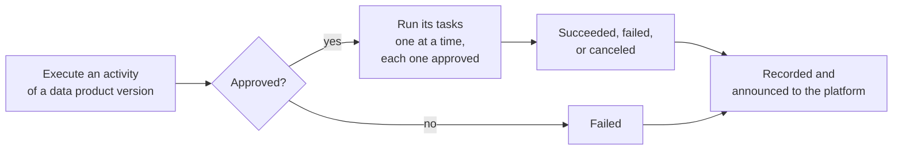

# ODM Platform DevOps Server

> The product-plane DevOps service for the [Open Data Mesh Platform](https://dpds.opendatamesh.org/) —
> manage the lifecycle of a data product version inside the physical infrastructure.

<p align="center">
  <a href="https://github.com/opendatamesh-initiative/odm-platform-pp-devops-server/actions/workflows/ci.yml"></a>
  <a href="https://opensource.org/licenses/Apache-2.0"></a>
</p>

<p align="center">
  <a href="https://openjdk.org/"></a>
  <a href="https://spring.io/projects/spring-boot"></a>
</p>

<p align="center">
  <a href="#what-devops-does">What DevOps does</a> ·
  <a href="#quick-start-local">Quick start</a> ·
  <a href="#run-with-docker">Docker</a> ·
  <a href="#documentation">Documentation</a> ·
  <a href="#contributing">Contributing</a>
</p>

---

## What DevOps does

DevOps is the platform service that manages the **lifecycle of a data product version inside the physical infrastructure**. It brings a published version into each environment (for example development, then QA, then production), so that every step is approved, runs in the right order, and is recorded.

- The phases of the lifecycle are called **activities**. An activity usually matches an environment, such as `dev` or `prod`. Activities are declared in the data product descriptor.
- Each activity contains one or more **tasks**. A task is one step needed to provision the version in that environment. Each task runs a **pipeline**: a CI/CD pipeline on a Git provider, or any automated process that can be started from outside.
- DevOps does not do the provisioning itself. It **coordinates** the pipelines the data product team already has. Either DevOps starts them and follows them (**full control**), or they start on their own and report back to DevOps (**instrumented**).
- Before an activity starts, and before each task starts, the execution must be **approved** by the organization's **policies**.



**Want the details?** Read [How DevOps works](docs/service/how-devops-works.md). It walks through the process first, then each capability: activities and tasks, full control and instrumented pipelines, executors, passing results between tasks, policies, and cancel.

---

## Quick start (local)

**Requirements:** Java **21** · Maven **3.6+** · Docker (for Testcontainers / `mvn verify`)

```bash
git clone https://github.com/opendatamesh-initiative/odm-platform-pp-devops-server.git
cd odm-platform-pp-devops-server

mvn clean install
mvn spring-boot:run -Dspring-boot.run.profiles=dev
```

The `dev` profile uses an in-memory **H2** database (port **8002**). When the server is up:

| | Endpoint |
|:--|:---------|
| **Swagger UI** | [http://localhost:8002/swagger-ui.html](http://localhost:8002/swagger-ui.html) |
| **OpenAPI** | [http://localhost:8002/v3/api-docs](http://localhost:8002/v3/api-docs) |

API prefix: **`/api/v2/pp/devops/`**.

More detail: [Development](docs/setup/development.md)

---

## Run with Docker

```bash
mvn clean package
docker build -t odm-platform-pp-devops-server .

docker run -p 8080:8080 \
  -e DB_JDBC_URL=jdbc:postgresql://host.docker.internal:5432/odm_devops \
  -e DB_USERNAME=your_username \
  -e DB_PASSWORD=your_password \
  -e PROFILES_ACTIVE=docker \
  odm-platform-pp-devops-server
```

| Guide | Link |
|:------|:-----|
| Step-by-step deploy | [Deployment](docs/setup/deployment.md) |
| Properties to manage | [Configuration](docs/setup/configuration.md) |

---

## Documentation

All guides live under [`docs/`](docs/README.md). Agent onboarding: [`AGENTS.md`](AGENTS.md).

<details open>
<summary><strong>Service</strong></summary>

<br>

| Guide | Description |
|:------|:------------|
| [How DevOps works](docs/service/how-devops-works.md) | **Start here.** The lifecycle process, then each capability in detail |
| [Events](docs/service/events.md) | Reference: messages for approvals and outcomes |

</details>

<details open>
<summary><strong>Setup</strong></summary>

<br>

| Guide | Description |
|:------|:------------|
| [Development](docs/setup/development.md) | Build, run, profiles, testing |
| [Deployment](docs/setup/deployment.md) | Containers and external dependencies |
| [Configuration](docs/setup/configuration.md) | DB, Notification, Policy, executors |

</details>

---

## Contributing

Contributions are welcome.

1. Fork the repository and create a feature branch
2. Make your changes with clear commits
3. Open a pull request against the main branch

Bugs, questions, or proposals → [open an issue](https://github.com/opendatamesh-initiative/odm-platform-pp-devops-server/issues).

---

## License

Licensed under the [Apache License 2.0](https://www.apache.org/licenses/LICENSE-2.0).

Part of the [Open Data Mesh Initiative](https://github.com/opendatamesh-initiative).
