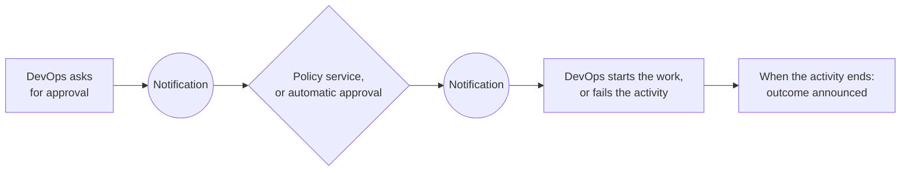

# Events

Reference list of the messages DevOps exchanges with the rest of the platform. Read [How DevOps works](how-devops-works.md) first: this page is the low-level detail for people who write a Policy service, or who want to react when an activity ends.

Related: [How DevOps works](how-devops-works.md) · [Configuration](../setup/configuration.md)

## Role of events

DevOps exchanges messages with the rest of the platform through the Notification service. It uses them for two things:

- **Approvals.** DevOps publishes a request each time an activity or a task needs approval, and waits for the answer. The answer comes from the Policy service or, while the Policy service is inactive, from DevOps itself. See [Policies](how-devops-works.md#6-policies-approving-executions).
- **Outcomes.** DevOps announces when an activity has succeeded, failed, or been canceled, so other services can react.

Notification must be active, and able to reach DevOps, for approvals to arrive. Otherwise an execution stays `PENDING`. See [Configuration](../setup/configuration.md#notification-service).

## Event catalogue

### Approval of an activity

| Event | Published by | Meaning | Content |
|---|---|---|---|
| `ACTIVITY_EXECUTION_REQUESTED` | DevOps | An activity has been requested and waits for approval | The activity, its position in the lifecycle, its data product version, and its tasks |
| `ACTIVITY_EXECUTION_APPROVED` | Policy service, or DevOps when the Policy service is inactive | The activity may start | Which activity |
| `ACTIVITY_EXECUTION_REJECTED` | Policy service | The activity is refused, and fails | Which activity |

### Approval of a task

| Event | Published by | Meaning | Content |
|---|---|---|---|
| `ACTIVITY_TASK_EXECUTION_REQUESTED` | DevOps | A task is about to run and waits for approval | The activity (without its other tasks), and the task to run |
| `ACTIVITY_TASK_EXECUTION_APPROVED` | Policy service, or DevOps when the Policy service is inactive | The task may run | Which activity and which task |
| `ACTIVITY_TASK_EXECUTION_REJECTED` | Policy service | The task is refused. It fails, and so does its activity. | Which activity and which task |

A task approval is requested in the same way in both execution modes. For a full-control task, DevOps requests it when the task's turn comes. For an instrumented task, DevOps requests it when the ODM CLI asks to run the task.

### Outcome of an activity

| Event | Published by | Meaning | Content |
|---|---|---|---|
| `ACTIVITY_SUCCEEDED` | DevOps | Every task has succeeded | The finished activity |
| `ACTIVITY_FAILED` | DevOps | A task failed, or a policy refused the activity or one of its tasks | The finished activity |
| `ACTIVITY_CANCELED` | DevOps | The owner canceled the activity | The finished activity |

## What messages never contain

- Credentials. They are never part of any message.
- Logs and results of the tasks.
- The other activities of the same data product version.

Pipeline locations and pipeline inputs do appear in approval requests, so the Policy service can check them. They are not secret.

---

↑ Back to the [docs index](../README.md)
