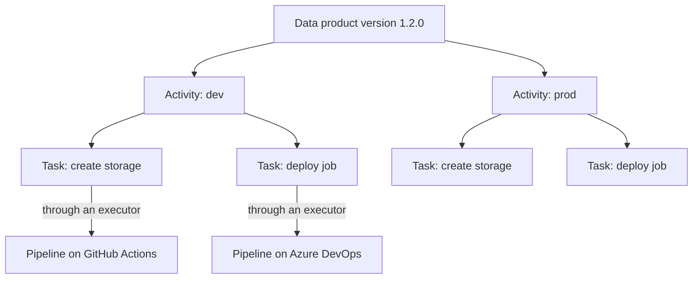
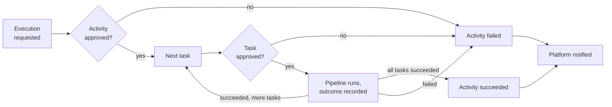
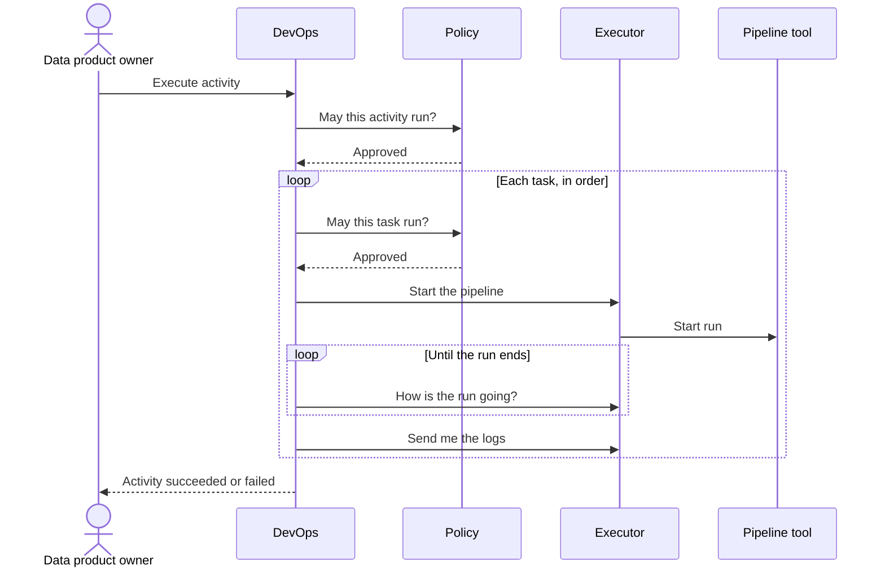
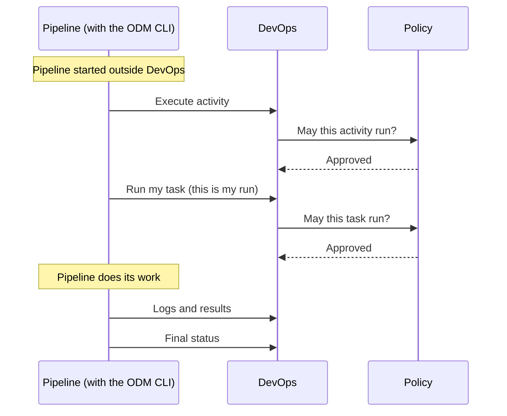

# How DevOps works

This page explains what the DevOps service is for and how its process is organized. It starts with the big picture, then covers each capability in its own section.

Each capability section has the same three parts:

- **In short**: what the capability is for, in business terms.
- **How it works**: the process, step by step.
- **Details**: what you need to know when you configure DevOps or integrate with it. Read this part only when you need it.

DevOps is treated here as a black box. The page describes what DevOps does and what to expect from it, not how it is built.

Related: [Events](events.md) (reference) · [Configuration](../setup/configuration.md)

## Contents

1. [The big picture](#1-the-big-picture)
2. [Activities and tasks: the lifecycle](#2-activities-and-tasks-the-lifecycle)
3. [How pipelines are managed: full control and instrumented](#3-how-pipelines-are-managed-full-control-and-instrumented)
4. [Executors](#4-executors)
5. [Passing results from one task to the next](#5-passing-results-from-one-task-to-the-next)
6. [Policies: approving executions](#6-policies-approving-executions)
7. [Canceling and failures](#7-canceling-and-failures)
8. [Known limitations](#8-known-limitations)

---

## 1. The big picture

### What DevOps is for

DevOps is the platform service that manages the **lifecycle of a data product version inside the physical infrastructure**.

When a data product version is published in the Registry, it is a description: what the product is, what it exposes, how it should be built. DevOps is what brings that version to life in the infrastructure, one environment at a time (for example development, then QA, then production). It does so in a way that is **governed** (each step must be approved), **ordered** (steps happen in the declared sequence), and **traceable** (every execution is recorded, with its logs and results).

DevOps does not provision infrastructure itself. The real work (creating storage, deploying jobs, granting access, and so on) is done by the automation the data product team already has, such as CI/CD pipelines on their Git provider. DevOps **coordinates** that automation: it decides what runs and in which order, asks for approval, follows the outcome, and keeps the record.

### The concepts, from the top

- **Lifecycle.** Before it is fully operational, a data product version goes through a series of phases.
- **Activity.** Each phase of the lifecycle is an *activity*. An activity often matches an environment of the infrastructure, such as `dev`, `qa`, or `prod`.
- **Declared in the descriptor.** The activities of a version are declared in the data product descriptor, together with the work each one requires. The data product team writes this once, as part of the version.
- **Task.** Each activity contains one or more *tasks*. A task is one step needed to provision that data product version in the environment the activity stands for. Examples: "create the storage", "deploy the transformation job", "register the output ports". Tasks run one after another, in the declared order.
- **Pipeline.** Each task corresponds to one *pipeline*. A pipeline is an automated process that lives outside DevOps and does the actual work. Typically it is a CI/CD pipeline on a Git provider (a GitHub Actions workflow, a GitLab CI pipeline, an Azure DevOps pipeline, a Bitbucket pipeline). It can also be any external process that can be started through a REST API, such as a job scheduler or an in-house provisioning service.
- **Executor.** DevOps reaches each pipeline tool through an *executor*: a connector that knows how to start, follow, and stop pipelines on one specific tool. Each task names the executor it uses.
- **Execution mode.** A pipeline can be started and followed by DevOps (**full control**), or started elsewhere and report its progress to DevOps (**instrumented**). In the instrumented case, a small command-line tool inside the pipeline (the ODM CLI) does the reporting.
- **Policies.** Before an activity starts, and again before each of its tasks starts, the execution must be approved. Approval is delegated to the Policy service, which applies the organization's rules.

### The process at a glance

1. **Someone asks to execute an activity** of a data product version. Usually this is the data product owner, from the platform user interface. It can also be a pipeline that is already running, through the ODM CLI. The request contains the activity and its tasks, as declared in the descriptor.
2. **DevOps records a new execution and asks for approval.** Nothing runs until the execution is approved.
3. **Once the activity is approved, its tasks run one at a time.** Each task is approved in turn, then its pipeline runs, then DevOps records its logs, results, and outcome.
4. **The activity ends.** It *succeeds* when every task has succeeded. It *fails* as soon as one task fails, and the tasks after it are not run. The owner can also *cancel* it while it is in progress.
5. **DevOps announces the outcome** to the rest of the platform.

Every execution is kept. Executing an activity again creates a new execution, and the previous ones stay available with their logs and results. Over time, this is the history of how each version reached each environment.

---

## 2. Activities and tasks: the lifecycle

### In short

An activity is one phase in the life of a data product version, usually one environment. Executing it means running, in order, every step needed to provision that version in that environment. DevOps makes sure the steps run in sequence, stops at the first failure, and records what happened.

### How it works

**Declaring the lifecycle.** The data product team declares the activities and their tasks in the data product descriptor. For each task they say which executor runs it, where its pipeline is, and which inputs it needs.

**Requesting an execution.** DevOps does not read the descriptor. Whoever requests the execution (the platform user interface, or the ODM CLI) reads the declared activity and sends it to DevOps as a plain list of tasks. This keeps DevOps independent of the descriptor format and its versions. Checking that the request matches what the descriptor declares is a job for [policies](#6-policies-approving-executions).

**One open execution at a time.** A data product version can have only one open execution of a given activity at a time. A second request for the same activity is refused until the first one has ended. Different activities of the same version can be open at the same time, unless a policy forbids it.

**Order between activities.** Each request carries the position of the activity in the lifecycle (for example, `dev` comes before `prod`). DevOps passes that position on to the Policy service, so a policy can require "dev must have succeeded before prod starts". DevOps does not enforce the order of activities itself.

**Order between tasks.** DevOps does enforce the order of tasks. Within an activity, tasks run strictly one at a time, in the declared order. A task cannot start while another task is running, or while an earlier task is still waiting.

**How an activity ends.**

| What happens | Result |
|---|---|
| Every task succeeds | The activity **succeeds** |
| A task fails | The activity **fails**. The tasks that had not started yet are **canceled** and never run. |
| The activity or one of its tasks is refused by a policy | The activity **fails** |
| The owner cancels the activity | See [Canceling and failures](#7-canceling-and-failures) |

### Details

Activities and tasks share the same five statuses:

| Status | Meaning |
|---|---|
| `PENDING` | Recorded, waiting to start (for example, waiting for approval, or waiting for its turn) |
| `RUNNING` | In progress |
| `SUCCEEDED` | Finished successfully |
| `FAILED` | Finished unsuccessfully, or refused by a policy |
| `CANCELED` | Stopped before completion, or never started because the activity ended first |

For each execution, DevOps keeps:

- the data product version and the activity it belongs to, with the activity's position in the lifecycle;
- each task, with the executor it used, the inputs it received, and a reference to the pipeline run in the external tool;
- start and end times;
- the logs and results of each task.

Secrets are never part of what DevOps keeps (see [Executors](#4-executors)).

---

## 3. How pipelines are managed: full control and instrumented

### In short

There are two ways a pipeline can take part in a lifecycle.

- **Full control** (DevOps-controlled). DevOps is in charge. It starts the pipeline, follows it until it ends, and collects its logs. Use it when you want the platform to be the single place where deployments are launched.
- **Instrumented.** The pipeline is in charge. It is started outside DevOps (by a merge, a tag, a schedule, or a person in the Git provider). A step inside the pipeline, the ODM CLI, reports to DevOps. Use it when teams already launch their pipelines from their own tools, and you want those runs governed and tracked without changing how they are started.

In both modes the activity follows the same lifecycle, is approved by the same policies, and ends the same way. The mode belongs to the [executor](#4-executors), so one activity can mix both kinds of task.

### How full control works

1. The data product owner asks DevOps to execute an activity.
2. The activity is approved.
3. For each task, in order:
   1. DevOps asks for approval of the task.
   2. Once approved, DevOps asks the task's executor to start the pipeline.
   3. DevOps checks the run at regular intervals until it ends.
   4. When the run has ended, DevOps collects its logs and records the outcome.
4. DevOps moves on to the next task, or ends the activity.

### How instrumented works

1. The pipeline starts, outside DevOps.
2. The ODM CLI, as a step of the pipeline, asks DevOps to execute the activity, and waits until the activity is approved.
3. The CLI asks DevOps to run its task, and tells DevOps which pipeline run it is. It waits until the task is approved.
4. The pipeline does its work. Meanwhile, the CLI sends DevOps the logs and the results.
5. At the end, the CLI reports the final status: succeeded, failed, or canceled.
6. DevOps moves on to the next task, or ends the activity.

DevOps never contacts the pipeline tool for an instrumented task. It only records what the CLI reports.

### Mixing the two modes

When a task ends, what happens next depends on the mode of the next task:

| Next task | Who starts it |
|---|---|
| Full control | DevOps, right away |
| Instrumented | The pipeline, through the CLI, when it is ready. Until then the task waits. |

For example, an activity can provision storage with a pipeline DevOps launches (full control), then wait for a deployment pipeline that the team triggers from their Git provider (instrumented).

### Details

**Full control**

- DevOps checks a running pipeline at a fixed interval, every 30 seconds by default.
- It stops checking after the lifetime of the executor credentials, one hour by default (so 120 checks with the defaults). A pipeline still running at that point is recorded as failed.
- Logs are collected once, when the run has ended.
- Both values can be changed in the [configuration](../setup/configuration.md#full-control-polling).

**Instrumented**

- The ODM CLI refers to the execution by data product, version, and activity name, and to its task by task name. Task names must therefore be unique within an activity.
- The CLI can only ask to run the next task in order, and only when no other task of the activity is running.
- Logs and results are accepted only while the task is running. The final status must be the last report: after it, the task no longer accepts logs or results.
- An instrumented task needs no executor address, no pipeline location, and no credentials, because DevOps does not call anything for it.

---

## 4. Executors

### In short

An executor is the connector between DevOps and one pipeline tool, such as GitHub Actions, GitLab, Azure DevOps, Bitbucket, or any system that can be started through a REST API. Executors keep DevOps independent of the tools: supporting a new tool means adding an executor, not changing DevOps.

### How it works

**Declaring executors.** The platform administrator declares the available executors in the DevOps configuration. Each one has a name and an execution mode (full control or instrumented). A full-control executor also has the address where DevOps can reach it.

**Choosing an executor.** Each task in the descriptor names the executor that runs it. Tasks of the same activity can use different executors, for example one task on GitHub and the next on Azure DevOps.

**What a full-control executor does.** DevOps asks it to start a pipeline run, to report how the run is going, to return the run's logs, and to stop a run. The executor translates each request for its tool, and reports back in a common vocabulary: running, succeeded, failed, or canceled.

**What an instrumented executor is.** Only a name and a mode. DevOps never calls it. It identifies the tasks whose progress is reported by the ODM CLI.

**What an executor knows.** An executor receives only what it needs to run a pipeline:

- where the pipeline is: the repository, the version tag or branch, and which pipeline to run;
- the inputs to pass to the pipeline;
- the credentials to use with the tool.

It knows nothing about activities, data product versions, or policies.

### Details

**Pipeline location and pipeline inputs.** A task gives its executor two separate things:

- the **pipeline location**, which tells the executor which pipeline to start, in which repository, and at which tag or branch;
- the **pipeline inputs**, free key-value pairs defined by the data product team, passed to the pipeline as its parameters. Input values can refer to the results of earlier tasks (see [Passing results](#5-passing-results-from-one-task-to-the-next)).

DevOps checks only what every tool needs. Requirements specific to one tool (for example, GitHub needs the workflow to run) are checked by its executor, and a failure shows up as a failed task.

**How tool statuses are reported.** Each executor maps its tool's statuses to the common vocabulary:

- a run waiting for a person or a resource (for example, a manual approval in the tool) is reported as *running*, so DevOps keeps waiting;
- a run stopped because DevOps asked the executor to stop it, or canceled directly in the tool, is reported as *canceled*;
- any other unsuccessful ending (timed out, skipped, and so on) is reported as *failed*.

**Credentials (secrets).** Most tools need credentials, such as an API token. In full control:

- the person or system that requests the execution supplies the credentials, one set per executor;
- DevOps keeps them in memory only for the duration of the activity, up to a maximum lifetime (one hour by default);
- DevOps sends them only to the executor they belong to;
- credentials are never stored, logged, returned, or included in notifications.

Pipeline locations and pipeline inputs are not secret. They are stored, shown, and included in the requests sent to the Policy service. Do not put credentials in pipeline inputs.

**Starter executor.** The Open Data Mesh initiative provides a starter executor that simulates pipeline runs. It is meant for demos, tests, and as a template for writing new executors.

How to declare executors and set the credential lifetime: [Configuration](../setup/configuration.md#executors).

---

## 5. Passing results from one task to the next

### In short

A task can produce results, such as the address of the storage it created or the identifier of a deployed job. Later tasks can use those results as inputs. This lets a lifecycle be a chain of pipelines, each one building on what the previous one produced, without hard-coding values in the descriptor.

### How it works

1. While a task's pipeline runs, it sends its results to DevOps through the ODM CLI. This works in both modes.
2. A later task declares an input whose value refers to one of those results.
3. Just before DevOps starts that later task's pipeline, it replaces the reference with the actual value.

### Details

- A reference has the form `${<activityName>.results.<taskName>.<path>}`. For example, `${dev.results.create-storage.bucketUrl}`.
- References can point to any activity of the same data product version, including the current one. DevOps uses the most recent execution of that activity, and the most recent run of that task.
- Only results of tasks that **succeeded** are used. Partial results of a failed or canceled task are kept for inspection, but they are never passed on.
- A reference that cannot be resolved is left unchanged.
- References are filled in only when DevOps starts the pipeline, which means in full control. An instrumented pipeline reads the values it needs itself.

---

## 6. Policies: approving executions

### In short

Policies let the organization decide what may run, where, and when. Examples of rules: "production can only be deployed from a released version", "dev must have succeeded before prod", "the tasks must be the ones declared in the descriptor". DevOps never starts an activity or a task without an approval.

### How it works

**Two checkpoints.** Approval is asked twice:

- once for the **activity**, before anything runs;
- once for **each task**, just before it runs.

**Who decides.**

| Policy service | What happens |
|---|---|
| **Active** | An external Policy service evaluates each request and approves or refuses it. DevOps waits for the answer. |
| **Inactive** | DevOps approves every request automatically, without any check. |

**What a refusal means.**

- A refused activity **fails**. None of its tasks run.
- A refused task **fails**, and so does its activity. The tasks after it are canceled.

A refusal is recorded as a failure, not as a cancellation. Cancellation is always a decision of the owner.

**How the answer travels.** DevOps and the Policy service exchange requests and answers through the platform's Notification service. Notification must therefore be active and able to reach DevOps. Without it, an execution waits for approval forever and stays `PENDING`.

**Who checks which order.** The Policy service is responsible for the order of activities (for example, dev before prod). DevOps is responsible for the order of tasks within an activity (see [Activities and tasks](#2-activities-and-tasks-the-lifecycle)).

### Details

- **What a policy sees.** Each approval request contains the activity, its position in the lifecycle, and the data product version it belongs to. A task request also contains the task, with its executor, pipeline location, and pipeline inputs. Credentials are never included.
- **What a policy does not see.** DevOps does not send the descriptor. The approval messages themselves do not list the other activities of the version, nor the other tasks of an activity. The document sent to a Policy service at version 1 is different: it adds them (see [Events](events.md#what-messages-never-contain)). A Policy service that needs anything else reads it from the Registry.
- **Automatic approval is a trust gap.** With the Policy service inactive, DevOps runs whatever it is asked to run, on any declared executor. Use it for development and demos, and activate the Policy service wherever governance matters.
- **Message names.** The exact messages DevOps publishes and expects are listed in [Events](events.md).
- How to turn the Policy service on or off: [Configuration](../setup/configuration.md#policy-service).

---

## 7. Canceling and failures

### In short

The owner can stop an activity that is still waiting or running. DevOps stops what can be stopped, prevents anything else from starting, and returns the activity once it has ended. Technical failures (a tool that does not answer, a pipeline that never ends) fail the task, so an activity never stays open because of them.

### How it works

**Canceling an activity.**

1. Every task that has not started yet is canceled at once. It will never run.
2. If a task is running:
   - in **full control**, DevOps asks its executor to stop the pipeline run;
   - in **instrumented** mode, DevOps cannot stop the pipeline. It waits for the CLI to report the final status.
3. Once the running task has ended, the activity ends, and DevOps returns it to the owner.

**How a canceled activity ends.** A cancel can arrive too late to change a running pipeline. The running task keeps its real outcome, and the activity ends accordingly:

| Running task ends as | Activity ends as | Why |
|---|---|---|
| Canceled | `CANCELED` | The pipeline was stopped |
| Succeeded, and later tasks were canceled | `CANCELED` | The activity did not complete |
| Succeeded, and it was the last task | `SUCCEEDED` | The cancel came too late; nothing was left to stop |
| Failed | `FAILED` | A real failure is always reported as such |

**Technical failures.**

| What goes wrong | Result |
|---|---|
| The executor cannot start the pipeline | The task fails, and so does the activity |
| DevOps cannot get the status of a running pipeline | The task fails after the last attempt |
| A pipeline is still running when DevOps stops checking | The task fails |
| An instrumented pipeline reports failed or canceled | The activity fails or is canceled |

### Details

- **Canceling an activity that has already ended** is refused, and the answer says how it ended.
- **Canceling at the same moment as another change** (for example, while the activity is being approved) can be refused as a conflict. Cancel again.
- **If DevOps cannot reach the executor to stop a run,** it tries a few times, then reports an error. Tasks that had not started stay canceled. Cancel again to retry stopping the run.
- **If a pipeline has just been started** and the tool has not identified the run yet, DevOps waits up to five minutes before giving up with an error. Cancel again later.
- **Cancel waits for the end.** The cancel request returns only when the activity has ended. With a slow pipeline, this can take as long as the pipeline needs to stop.

---

## 8. Known limitations

- **Restarting DevOps during a run.** A full-control task that was running stays `RUNNING`, because DevOps does not resume following it, and the credentials held in memory are lost. Automatic recovery after a restart is not supported yet.
- **A silent instrumented pipeline.** If an instrumented pipeline never asks to run its task, or never reports a final status, the activity stays open. A cancel waits for that pipeline too.
- **Credential lifetime.** Credentials expire after their lifetime (one hour by default), counted from the execution request. A task that starts later runs without them.
- **One instance.** Credentials and in-progress runs are held in the memory of one DevOps instance. Run a single instance.

---

↑ Back to the [docs index](../README.md)
