# Policy V1 Adapter for DevOps Execution Requests

Analysis: `spdd/analysis/BDMD-5438-202610131149-[Analysis]-policy-v1-adapter.md` (Revision 7). Decision IDs (DD-1 to DD-11) are cited in code, tests, and review comments. The Policy server change for filtering expressions (DD-11) is in `odm-platform/product-plane-services/policy-server`.

## Requirements

Implement a temporary compatibility adapter that, when Policy is active at version 1, evaluates the two DevOps V2 execution requests (`ACTIVITY_EXECUTION_REQUESTED`, `ACTIVITY_TASK_EXECUTION_REQUESTED`) against Policy Service V1 and answers each with the V2 approval or rejection the existing use cases already accept.

- Value: governance can gate activity and task execution while Policy V2 does not exist, with no change to the core use cases. The Policy server change for filtering expressions is part of the same story (DD-11).
- Scope: one package, deleted when Policy V2 reads the V2 events. The use cases stay the only writers of status.
- Boundaries: only the two request events are mapped. `ACTIVITY_STAGE_TRANSITION`, activity succeeded/failed/canceled, and the V1 notification broadcasts are not sent. Old V1 policy documents are not supported. Filtering expressions on the two result names are supported against the policy input, with V2 field names and V2 status values, once the Policy server change (DD-11) is deployed (DD-8).

## Entities

```mermaid
classDiagram
direction TB

class NotificationEventHandler {
    <<interface>>
    +supportsEventType(EventTypeRes) boolean
    +handleEvent(NotificationDispatchEventRes) void
}

class PolicyServiceV1Configuration {
    <<Configuration, conditional>>
    +policyV1InputEnricher(ActivityService, ObjectMapper) PolicyV1InputEnricher
    +notificationEventHandlerActivityExecutionRequested(NotificationClient, PolicyClientV1, PolicyV1InputEnricher) NotificationEventHandler
    +notificationEventHandlerActivityTaskExecutionRequested(NotificationClient, PolicyClientV1, PolicyV1InputEnricher) NotificationEventHandler
}

class PolicyClientV1Config {
    <<Configuration, conditional>>
    +policyClientV1(RestTemplateBuilder) PolicyClientV1
}

class PolicyClientV1 {
    <<interface>>
    +validateInput(PolicyResPolicyEvaluationRequest, boolean) PolicyResValidationResponse
}

class PolicyClientV1Impl {
    -RestUtils restUtils
    -String policyServiceBaseUrl
}

class PolicyV1InputEnricher {
    -ActivityService activityService
    -ObjectMapper objectMapper
    +forActivityExecution(JsonNode, String, String) ObjectNode
    +forTaskExecution(JsonNode, String) ObjectNode
}

class NotificationEventHandlerActivityExecutionRequested {
    +handleEvent(NotificationDispatchEventRes) void
}

class NotificationEventHandlerActivityTaskExecutionRequested {
    +handleEvent(NotificationDispatchEventRes) void
}

class PolicyV1LegacyIdentifier {
    +fromFqn(String) String
}

class PolicyV1Decision {
    +hasBlockingFailure(PolicyResValidationResponse) boolean
}

class PolicyResPolicyEvaluationRequest {
    +ResourceType resourceType
    +String dataProductId
    +String dataProductVersion
    +EventType event
    +JsonNode currentState
    +JsonNode afterState
}

class PolicyResValidationResponse {
    +Boolean result
    +List~PolicyResPolicyEvaluationResult~ policyResults
}

class PolicyResPolicyEvaluationResult {
    +Boolean result
    +PolicyResPolicy policy
}

class PolicyResPolicy {
    +Boolean blockingFlag
}

class EventReceivedActivityExecutionRequested {
    +EventContent eventContent
    +Activity activity
}

class EventReceivedActivityTaskExecutionRequested {
    +EventContent eventContent
    +Activity activity
    +Task task
}

class EventEmittedActivityExecutionRejected {
    +resourceIdentifier
    +eventContent.activity
}

class EventEmittedActivityTaskExecutionRejected {
    +resourceIdentifier
    +eventContent.activity
    +eventContent.task
}

class EmittedEventActivityExecutionApprovedRes {
    <<existing>>
}

class EmittedEventActivityTaskExecutionApprovedRes {
    <<existing>>
}

class ActivityService {
    <<existing, core>>
    +findAllResourcesFiltered(Pageable, ActivitySearchOptions) Page~ActivityRes~
    +findOneResource(String) ActivityRes
}

class ActivityRes {
    <<existing>>
    +uuid, dataProductVersionUuid
    +dataProductFqn, dataProductVersionTag
    +name, sortOrder, status, startedAt, finishedAt, tasks
}

class TaskRes {
    <<existing>>
    +uuid, name, sortOrder, status, results
}

NotificationEventHandler <|.. NotificationEventHandlerActivityExecutionRequested
NotificationEventHandler <|.. NotificationEventHandlerActivityTaskExecutionRequested
PolicyServiceV1Configuration ..> NotificationEventHandlerActivityExecutionRequested : creates
PolicyServiceV1Configuration ..> NotificationEventHandlerActivityTaskExecutionRequested : creates
PolicyServiceV1Configuration ..> PolicyV1InputEnricher : creates
PolicyClientV1Config ..> PolicyClientV1Impl : creates
PolicyClientV1 <|.. PolicyClientV1Impl
PolicyV1InputEnricher --> ActivityService : reads activities
PolicyV1InputEnricher --> ActivityRes : otherActivities, activity.tasks
NotificationEventHandlerActivityExecutionRequested --> PolicyV1InputEnricher : afterState
NotificationEventHandlerActivityTaskExecutionRequested --> PolicyV1InputEnricher : afterState
NotificationEventHandlerActivityExecutionRequested --> PolicyClientV1 : validateInput
NotificationEventHandlerActivityTaskExecutionRequested --> PolicyClientV1 : validateInput
NotificationEventHandlerActivityExecutionRequested --> PolicyV1LegacyIdentifier : dataProductId
NotificationEventHandlerActivityTaskExecutionRequested --> PolicyV1LegacyIdentifier : dataProductId
NotificationEventHandlerActivityExecutionRequested --> PolicyV1Decision : judges
NotificationEventHandlerActivityTaskExecutionRequested --> PolicyV1Decision : judges
EventReceivedActivityExecutionRequested --> PolicyResPolicyEvaluationRequest : eventContent enriched into afterState
EventReceivedActivityTaskExecutionRequested --> PolicyResPolicyEvaluationRequest : eventContent enriched into afterState
PolicyResValidationResponse "1" -- "*" PolicyResPolicyEvaluationResult
PolicyResPolicyEvaluationResult --> PolicyResPolicy
PolicyResValidationResponse --> EmittedEventActivityExecutionApprovedRes : no blocking failure
PolicyResValidationResponse --> EventEmittedActivityExecutionRejected : blocking failure
PolicyResValidationResponse --> EmittedEventActivityTaskExecutionApprovedRes : no blocking failure
PolicyResValidationResponse --> EventEmittedActivityTaskExecutionRejected : blocking failure
```



Existing types reused unchanged: `NotificationEventHandler`, `NotificationClient`, `EventTypeRes`, `ActivityService`, `ActivityRes`, `TaskRes`, `ActivitySearchOptions`, `EmittedEventActivityExecutionApprovedRes`, `EmittedEventActivityTaskExecutionApprovedRes`, `RestUtils`, `RestUtilsFactory`.

The Policy wire types are local copies of the Policy V1 resources, as in the Registry. They are not shared with the policy-server module.

## Approach

1. Solution category: compatibility adapter on the notification bus (DD-4, DD-5).
   - Same pattern as `odm-platform-pp-registry-server` `old.v1.policyservice`. Reference: `agent-reports/registry-v1-policy-adapter.md`.
   - The adapter subscribes to the two `*_REQUESTED` events when Policy is active at version 1. It builds the policy input, calls Policy V1, and emits the V2 approval or rejection on the bus. It never calls the approve or reject use cases. Those use cases stay the only writers of status, and they stay free of Policy types.
   - Handlers are not `@Component`. A conditional `@Configuration` builds them in `@Bean` methods, so the adapter is either fully present or fully absent. Core code does not import the package.
   - Only one handler may answer a request: the observer dispatches with `findFirst()`. The auto-approvers keep `active=false` (`matchIfMissing=true`). The adapter requires `active=true` and `version=1`. Any other combination has no answerer, and the work stays `PENDING`.

2. Technical implementation.
   - Spring `@ConditionalOnProperty`, Jackson for event conversion and for building the policy input, `RestUtils` for the HTTP call to `POST {address}/api/v1/pp/policy/validation` with `storeResults=true`.
   - The policy input is built in `PolicyV1InputEnricher` (DD-10). The enricher reads through the core `ActivityService`: `findAllResourcesFiltered` for the sibling activities and `findOneResource` for the tasks of an activity.
   - Subscription is derived: the existing subscriber unions `supportsEventType` over all handler beans, so no subscription list is added.
   - The decision is emitted with `notificationClient.notifyEvent(...)`. Notification delivers it back to the observer, where the existing approve and reject handlers apply it.
   - Id: `UUID.nameUUIDFromBytes(fqn.getBytes(UTF_8)).toString()`. No parser dependency (DD-7).
   - Error handling: no `GlobalExceptionHandler` change. A `ClientException` from Policy emits a rejection. A defect (missing activity, missing field) escapes the handler and `ObserverService` marks the notification failed (DD-6, DD-10).

3. Business logic.
   - Request mapping (DD-1, DD-2, DD-7, DD-8, DD-9): `ACTIVITY_EXECUTION_REQUESTED` becomes `ACTIVITY_EXECUTION_RESULT`, and `ACTIVITY_TASK_EXECUTION_REQUESTED` becomes `TASK_EXECUTION_RESULT`. `currentState` is omitted. `dataProductId` is the fqn-derived id. `dataProductVersion` is the version tag.
   - Policy input (DD-2, DD-10): for an activity request, `{ activity, otherActivities }`, where `activity` is the event's activity unchanged and `otherActivities` is the other activities of the same data product version as summaries, sorted by `sortOrder` nulls last. For a task request, `{ activity, task }`, where `activity` has a `tasks` list added (all tasks of the activity with their results and without their logs, sorted by `sortOrder` nulls last) and `task` is the requested task as the event carries it.
   - Dates (DD-10): every date in the policy input is an ISO-8601 text with milliseconds and an offset, for example `2026-10-15T15:19:00.123+00:00`, written by the same Jackson configuration as the events.
   - Judgement (DD-6): a failed policy with `blockingFlag=true` rejects. An empty or null result list approves. A failed non-blocking policy approves. The aggregate `result` flag is ignored.
   - Decision events carry the identifiers the use cases read, built the same way the existing auto-approvers build them: activity uuid, name, sort order, data product version uuid, and for a task the task uuid and name. `resourceIdentifier` is the activity uuid.
   - Filtering expressions on the two result names are supported on the policy input, with V2 names and values (DD-8). Policy evaluates them on raw JSON (DD-11).

## Structure

### Inheritance Relationships
1. `NotificationEventHandler` interface defines `supportsEventType` and `handleEvent`.
2. `NotificationEventHandlerActivityExecutionRequested` and `NotificationEventHandlerActivityTaskExecutionRequested` implement `NotificationEventHandler`. Both are package-private.
3. `PolicyClientV1` interface defines `validateInput(request, storeResults)`. `PolicyClientV1Impl` (package-private) implements it.
4. No new exception types.

### Dependencies
1. `PolicyServiceV1Configuration` builds `PolicyV1InputEnricher` from `ActivityService` and `ObjectMapper`, and builds the two handlers. It injects `NotificationClient`, `PolicyClientV1`, and `PolicyV1InputEnricher` into the handlers.
2. `PolicyClientV1Config` builds `PolicyClientV1Impl` from `RestTemplateBuilder`, `RestUtilsFactory`, and the property `odm.product-plane.policy-service.address`.
3. Each handler depends on `NotificationClient`, `PolicyClientV1`, `PolicyV1InputEnricher`, `PolicyV1LegacyIdentifier`, and `PolicyV1Decision`.
4. `PolicyV1InputEnricher` depends on the core `ActivityService` (the adapter package depends on core, never the other way round) and on `ObjectMapper`.
5. Nothing outside `...old.v1.policyservice` imports the package. The package imports `NotificationClient`, `NotificationEventHandler`, `EventTypeRes`, `ActivityService`, `ActivitySearchOptions`, `ActivityRes`, `TaskRes`, and the existing approved emitted resources.

### Layered Architecture
1. Configuration layer: the two conditional configurations select the mode and construct the beans.
2. Adapter layer (handlers): convert the received event, build the policy input through the enricher, build the Policy request, call Policy, judge the response, emit the decision.
3. Enrichment layer (`PolicyV1InputEnricher`): reads the sibling activities and the tasks through core services, and shapes them for the policy input.
4. Client layer: `PolicyClientV1` is the only code that speaks HTTP to Policy.
5. Wire layer: `PolicyRes*` and `EventReceived*` / `EventEmitted*` DTOs owned by the package.
6. Exception handling: the existing observer marks a failed notification. No new handler.

Package: `org.opendatamesh.platform.pp.devops.old.v1.policyservice`. The `old.v1` prefix matches the Registry layout. `old/README.md` states that the package is temporary and deleted when Policy V2 exists.

## Operations

### Add configuration properties - Policy
1. Responsibility: give DevOps the Policy configuration the adapter needs.
2. Attributes:
   - `odm.product-plane.policy-service.active`: boolean - already in `application.yml` (`false`).
   - `odm.product-plane.policy-service.version`: String - new. Absent by default.
   - `odm.product-plane.policy-service.address`: String - new. Read only when the adapter loads.
3. Logic:
   - Update `src/main/resources/application.yml` with a commented example of `version` and `address`, as the Registry does. Do not set a default `version`.
   - Do not change `application-dev.yml` or `application-localpostgres.yml`. The DevOps repo keeps its `src/main/resources/application*.yml` files as they are in this story.
4. Constraints: the existing auto-approvers keep `active=false`, `matchIfMissing=true`. Do not edit them.

### Create DTO - PolicyResPolicyEvaluationRequest, PolicyResValidationResponse, PolicyResPolicyEvaluationResult, PolicyResPolicy
1. Responsibility: local copies of the Policy V1 wire types. Copy the shape from `odm-platform-pp-registry-server` `old/v1/policyservice`.
2. Attributes:
   - `PolicyResPolicyEvaluationRequest`: `resourceType` (enum `ResourceType`), `dataProductId` (String), `dataProductVersion` (String), `event` (enum `EventType`), `currentState` (`JsonNode`), `afterState` (`JsonNode`).
   - `EventType`: at least `ACTIVITY_EXECUTION_RESULT`, `TASK_EXECUTION_RESULT`. Copy the Registry list so the contract matches.
   - `ResourceType`: at least `ACTIVITY_EXECUTION_RESULT`, `TASK_EXECUTION_RESULT`.
   - `PolicyResValidationResponse`: `result` (Boolean), `policyResults` (`List<PolicyResPolicyEvaluationResult>`).
   - `PolicyResPolicyEvaluationResult`: `result` (Boolean), `policy` (`PolicyResPolicy`).
   - `PolicyResPolicy`: `blockingFlag` (Boolean). Ignore unknown properties (`@JsonIgnoreProperties(ignoreUnknown = true)`) on response types so Policy fields we do not read cannot break deserialization.
3. Annotations: JavaBeans with getters and setters. Public, as in the Registry.
4. Constraints: `resourceType` is set to the same name as `event`. The Javadoc of each handler records why (Policy selects policies by `event`, and the server does not read `resourceType`).

### Create Client - PolicyClientV1 and PolicyClientV1Impl
1. Interface: `PolicyResValidationResponse validateInput(PolicyResPolicyEvaluationRequest evaluationRequest, boolean storeResults)`.
2. Implementation (package-private): `restUtils.genericPost(policyServiceBaseUrl + "/api/v1/pp/policy/validation", null, evaluationRequest, PolicyResValidationResponse.class)` when `storeResults` is `true`, and `/api/v1/pp/policy/validation-test` otherwise. The adapter only passes `true`.
3. Exception Handling: lets `ClientException` and `ClientResourceMappingException` propagate to the handler.
4. Dependency Injection: constructed by `PolicyClientV1Config`. Not a Spring stereotype.

### Create Configuration - PolicyClientV1Config
1. Annotations: `@Configuration`, `@ConditionalOnProperty(name = "odm.product-plane.policy-service.active", havingValue = "true")`, `@ConditionalOnProperty(name = "odm.product-plane.policy-service.version", havingValue = "1")`.
2. Methods: `PolicyClientV1 policyClientV1(RestTemplateBuilder restTemplateBuilder)`.
   - Logic: `RestUtilsFactory.getRestUtils(restTemplateBuilder.build())`, log the base URL at info, return `new PolicyClientV1Impl(restUtils, address)`.
3. Attributes: `@Value("${odm.product-plane.policy-service.address}") String policyServiceBaseUrl`.

### Create Enricher - PolicyV1InputEnricher (DD-10)
1. Responsibility: build the `afterState` policy input from the V2 event content, adding the context a policy needs and changing no existing field.
2. Attributes: `ActivityService activityService`, `ObjectMapper objectMapper`.
3. Methods:
   - `ObjectNode forActivityExecution(JsonNode eventContent, String activityUuid, String dataProductVersionUuid)`:
     - Logic: `requireText` on the activity uuid and the version uuid. Copy `eventContent` (`deepCopy`). Set `otherActivities`.
     - `otherActivities`: `findAllResourcesFiltered(Pageable.unpaged(), filters)` with `filters.setDataProductVersionUuid(dataProductVersionUuid)`. Drop the activity whose uuid equals `activityUuid`. Sort by `sortOrder` with `Comparator.nullsLast`. Map each to a summary with exactly `uuid`, `name`, `sortOrder`, `status` (the V2 enum name), `startedAt`, `finishedAt`. An empty list is `[]`.
   - `ObjectNode forTaskExecution(JsonNode eventContent, String activityUuid)`:
     - Logic: `requireText` on the activity uuid. Copy `eventContent`. Read the activity with `findOneResource(activityUuid)` and set `activity.tasks`. The `task` node is not changed.
     - `activity.tasks`: all tasks, sorted by `sortOrder` with `nullsLast`. For each task, set `logs` and `results` to null on the read object, convert with `objectMapper.valueToTree`, remove `logs`, and set `results` to a list of `{ uuid, content, generatedAt }`. A task with no results gives `[]`.
   - Dates: `dateNode(Date)` writes `objectMapper.valueToTree(date)` and `NullNode` for null.
4. Exception handling: `NotFoundException` from `findOneResource` propagates (defect, DD-10). `requireText` throws `BadRequestException` with `Missing '<field>' field in activity`.
5. Visibility: package-private class. No Spring stereotype. Created by `PolicyServiceV1Configuration`.

### Create Utility - PolicyV1LegacyIdentifier (DD-7)
1. Responsibility: compute the legacy fqn-derived product id that Policy stores.
2. Methods: `static String fromFqn(String fqn)`.
   - Logic: `UUID.nameUUIDFromBytes(fqn.getBytes(StandardCharsets.UTF_8)).toString()`.
   - Edge cases: a null or blank fqn throws `IllegalArgumentException` with a clear message. A request without an fqn is a defect, not a rejection, so it fails the notification.
3. Javadoc: state that the value equals `IdentifierStrategyFactory.getDefault().getId(fqn)` from the DPDS parser 1.x, that the parser is deliberately not a dependency because the adapter is temporary, that UTF-8 is pinned (the library uses the platform default), and cite DD-7. Give the two test vectors.
4. Visibility: package-private class, `final`, private constructor.

### Create Utility - PolicyV1Decision (DD-6)
1. Responsibility: judge a Policy response.
2. Methods: `static boolean hasBlockingFailure(PolicyResValidationResponse response)`.
   - Logic: `false` when `response` or `policyResults` is null. Otherwise `true` when any entry has `Boolean.FALSE.equals(result)` and a non-null `policy` with `Boolean.TRUE.equals(blockingFlag)`. The aggregate `response.result` is ignored.
3. Visibility: package-private, `final`.

### Create DTO - EventReceivedActivityExecutionRequested, EventReceivedActivityTaskExecutionRequested
1. Responsibility: package-owned view of the inbound event, with `eventContent` as `activity` (and `task` for a task request). The existing `Received*RequestedRes` types are not used, so the package does not depend on their shape.
2. Logic: the handler converts the dispatch event with the package `ObjectMapper` (`FAIL_ON_UNKNOWN_PROPERTIES` false). The raw `eventContent` `JsonNode` is kept and copied into the policy input, so the policy input keeps every V2 field the event carries.
3. Constraints: `@JsonIgnoreProperties(ignoreUnknown = true)`.

### Create Event DTO - EventEmittedActivityExecutionRejected, EventEmittedActivityTaskExecutionRejected
1. Responsibility: the rejection payloads the existing reject handlers read.
2. Attributes: mirror `EmittedEventActivityExecutionApprovedRes` and `EmittedEventActivityTaskExecutionApprovedRes` exactly, with `type` = `EventTypeRes.ACTIVITY_EXECUTION_REJECTED` or `ACTIVITY_TASK_EXECUTION_REJECTED`, `resourceType` = `ResourceType.ACTIVITY`, `eventTypeVersion` = `EventTypeVersion.V2_0_0`. Content: `activity` (`uuid`, `name`, `sortOrder`, `dataProductVersionUuid`) and, for tasks, `task` (`uuid`, `name`).
3. Constraints: the field set matches the rejected events that the reject use cases read. Only the uuids are read.
4. Visibility: package-private.

### Implement Handler - NotificationEventHandlerActivityExecutionRequested
1. Interface Definition: `NotificationEventHandler`. `supportsEventType(eventType)` returns `EventTypeRes.ACTIVITY_EXECUTION_REQUESTED.equals(eventType)`.
2. Core Method: `handleEvent(NotificationDispatchEventRes event): void`.
   - Input Validation: convert the event with the package `ObjectMapper`. A null event content or null activity throws `BadRequestException` with the messages `Missing 'content' field in event` and `Missing 'activity' field in event content`.
   - Business Logic:
     1. Build `PolicyResPolicyEvaluationRequest`: `event` = `ACTIVITY_EXECUTION_RESULT`, `resourceType` = `ACTIVITY_EXECUTION_RESULT`, `dataProductId` = `PolicyV1LegacyIdentifier.fromFqn(activity.dataProductFqn)`, `dataProductVersion` = `activity.dataProductVersionTag`, `currentState` = null, `afterState` = `inputEnricher.forActivityExecution(eventContent, activity uuid, activity dataProductVersionUuid)` (DD-2, DD-10).
     2. Call `policyClient.validateInput(request, true)`.
     3. If `PolicyV1Decision.hasBlockingFailure(response)` emit the rejected event, otherwise the approved event.
   - Exception Handling: catch `ClientException` around the Policy call only. Log a warning with the activity uuid and the code, and emit the rejected event (fail closed). Do not catch `RuntimeException`: an enrichment or mapping defect must surface as a failed notification (DD-6, DD-10).
   - Return Value: none. The decision is emitted with `notificationClient.notifyEvent`.
3. Approved event: build `EmittedEventActivityExecutionApprovedRes` with the four activity fields and `resourceIdentifier` = the activity uuid. Do not call the auto-approval service: it is a core `@Service` with the auto-approve conditions around its handler, and DD-5 keeps the package independent.
4. Rejected event: the same fields on `EventEmittedActivityExecutionRejected`.
5. Dependency Injection: constructor with `NotificationClient`, `PolicyClientV1`, and `PolicyV1InputEnricher`. No Spring annotations.

### Implement Handler - NotificationEventHandlerActivityTaskExecutionRequested
1. Same shape as the activity handler.
2. `supportsEventType` returns `EventTypeRes.ACTIVITY_TASK_EXECUTION_REQUESTED.equals(eventType)`.
3. Request: `event` = `TASK_EXECUTION_RESULT`, `resourceType` = `TASK_EXECUTION_RESULT`, `afterState` = `inputEnricher.forTaskExecution(eventContent, activity uuid)` (DD-2, DD-10): `{ activity (with tasks, results, no logs), task (as the event carries it) }`. `dataProductId` and `dataProductVersion` come from the event's activity.
4. Validation: null content, activity, or task throws `BadRequestException` with the messages `Missing 'content' field in event`, `Missing 'activity' field in event content`, and `Missing 'task' field in event content`.
5. Approved and rejected events carry the activity fields and the task `uuid` and `name`. `resourceIdentifier` is the activity uuid.

### Create Configuration - PolicyServiceV1Configuration
1. Annotations: `@Configuration`, both `@ConditionalOnProperty` conditions as in `PolicyClientV1Config`.
2. Methods:
   - `@Bean PolicyV1InputEnricher policyV1InputEnricher(ActivityService, ObjectMapper)`: returns `new PolicyV1InputEnricher(...)`.
   - `@Bean NotificationEventHandler notificationEventHandlerActivityExecutionRequested(NotificationClient, PolicyClientV1, PolicyV1InputEnricher)`: log at info `Registering NotificationEventHandlerActivityExecutionRequested`, return the handler.
   - `@Bean NotificationEventHandler notificationEventHandlerActivityTaskExecutionRequested(NotificationClient, PolicyClientV1, PolicyV1InputEnricher)`: the same for the task handler.
3. Constraints: bean names must not collide with the auto-approver beans.

### Document - old package README
1. `src/main/java/org/opendatamesh/platform/pp/devops/old/README.md`. Content: purpose, the three property combinations table (inactive, active with version 1, active with any other version), the event map, the policy input of each request (shapes, `otherActivities` and `activity.tasks` rules, ISO-8601 dates), the Known Limitations (filtering after DD-11, expressions limited to JSON, no lock on the context, no size limit on results, V2 names, `resourceType`, configuration, Notification), and the rule that deleting the `old` package and the Policy properties removes the adapter.
2. Remove the earlier claims that the task is sent with results and logs (DD-9 corrected) and that the conversion failure is a 500 (the V1 conversion returns a 400 `SC400_05_MALFORMED_INPUT_OBJECT`, and after DD-11 there is no conversion).

### Change Policy server - SpELUtils and the filtering contract (DD-8, DD-11)
Repository: `odm-platform`, module `product-plane-services/policy-server`. Same story, same branch `main`.
1. Responsibility: evaluate a policy's `filteringExpression` against the raw JSON input of an evaluation request.
2. Method: `public static boolean eventObjectMatchesSpelExpression(JsonNode inputObject, String spelExpression, EventType eventType)`. The signature does not change, so `ValidationService` does not change. `eventType` is used only in log messages.
3. Logic:
   - Parse the expression with `SpelExpressionParser`.
   - Convert the input to plain Java values with a private `ObjectMapper` that is not configured: `convertValue(inputObject, Object.class)`. The shared `ObjectMapperFactory.JSON_MAPPER` is not used and not changed.
   - Evaluate with `SimpleEvaluationContext.forPropertyAccessors(new JsonMapPropertyAccessor()).withInstanceMethods().build()`.
   - Return the result only if it is a `Boolean`. A non-boolean result, or an `EvaluationException`, logs an error that names the expression and the event, and returns `false` (the policy is filtered out).
4. `JsonMapPropertyAccessor` (private static nested class, implements `PropertyAccessor`): `getSpecificTargetClasses` returns `Map.class`. `canRead` is true for any `Map` target. `read` returns the value of the key, or `null` when the key is missing. `canWrite` is false. `write` throws `AccessException`.
5. Deleted: `EventTypeObjectConverterUtils`, and the classes `ActivityResultEvent`, `ActivityStageTransitionEvent`, `DataProductEvent`, `TaskResultEvent` in `...policy.server.resources`. The `PolicyApiStandardErrors` constants are kept (public API). The commented-out `convertJsonNodeToMap` block is removed.
6. Documentation in code (the constraints the user asked to document): the Javadoc of `SpELUtils` lists the constraints. Expressions run on the raw JSON whatever its shape. They use JSON field names, dot navigation or `['key']`. A missing key reads as `null`, and navigating into `null` is an error that filters the policy out (`?.` navigates safely). Only JSON values are available. Java getters of the old V1 classes are not. Instance methods of the values (`size()`, `startsWith('pr')`) can be called. `SimpleEvaluationContext` is used on purpose: type references `T(...)`, constructors, and bean references are not available.
7. Documentation: `product-plane-services/policy-api/README.md` describes the filtering expressions: JSON field names, bracket and dot navigation, a missing key reads as null, `?.`, JSON values, methods on the values, no `T()` and no constructors, and a boolean result required.
8. Tests: `SpELUtilsTest` in `policy-server/src/test/java/.../policy/server/utils/`, JUnit 5 with AssertJ, Java 11 source level (string concatenation for JSON). It covers: the V1 descriptor-style expression (true and false); a V2-shaped DevOps input (`afterState.activity.name` and `status`); list selection on `afterState.otherActivities` with `.?[...]`; a missing key reads as null; a `T(java.lang.Runtime)` expression does not run and returns false; a method on a string value; the shared mapper keeps `FAIL_ON_UNKNOWN_PROPERTIES` false after evaluation.
9. Maven: the policy-server surefire `includes` also runs `**/*Test.java`, not only `**/*IT.java`. Build with Java 11 (`JAVA_HOME` set to a JDK 11), because the module sources are Java 11.

## Norms

Read from the registry `spdd/norms/README.md`. Applicable files: `spdd/norms/USE_CASE_IMPLEMENTATION.md` (the adapter adds no use case, but its boundary rules apply) and `spdd/norms/GENERIC-CRUD-GUIDELINES.md` (read and found not applicable: no entity, repository, or migration is added).

1. Annotation Standards:
   - Handlers, the client impl, the enricher, and the helper classes are package-private plain Java classes with no Spring stereotype. This matches `USE_CASE_IMPLEMENTATION.md` §8 for port impls and the Registry pattern for handlers.
   - The two configuration classes are `@Configuration` with both `@ConditionalOnProperty` conditions. They are the only Spring beans in the package.
2. Dependency Injection: constructor injection through the `@Bean` methods. No field injection in the package. The auto-approvers are not modified.
3. Exception Handling:
   - Reuse `BadRequestException` for a malformed event, with the same messages as the existing auto-approvers.
   - Catch `ClientException` only, around the Policy call, and emit a rejection. Do not catch `RuntimeException` (DD-6).
   - A missing activity surfaces as the `NotFoundException` of the core service, unchanged (DD-10).
   - No new exception types and no `GlobalExceptionHandler` change.
4. Data Validation: validate that the content, the activity, and for a task the task are present. Validate that the fqn is present before computing the id, and the activity uuid and version uuid before the enrichment reads.
5. Logging: SLF4J. Info when a handler is registered. Warn when the Policy client fails and a rejection is emitted. Never log the policy input or the Policy request or response body.
6. Documentation Standards:
   - Javadoc on each handler and on the enricher cites the decision IDs it implements.
   - The `old/README.md` states that the package is temporary.
   - Test method Javadoc copies the Gherkin scenario verbatim.
7. Layering from `USE_CASE_IMPLEMENTATION.md`: business outcome rules stay in the use cases. The adapter holds the translation, the enrichment, and the judgement of the Policy response, which DD-6 places in the adapter. It does not call a use case, and no `*Res` type is imported into `...services.usecases.*`. The adapter package may use `*Res` types because it is an adapter. It reads activities through the core service, not through a repository.
8. Composed method (`USE_CASE_IMPLEMENTATION.md` §5, applied to the handlers and the enricher): `handleEvent` reads as a short outline (convert, build request, call Policy, judge, emit). Each step is a private method with an intent-revealing name.
9. Policy server (DD-11): filtering expressions are evaluated through `SimpleEvaluationContext`. No `StandardEvaluationContext` is used. The shared `ObjectMapperFactory.JSON_MAPPER` is never configured by filtering code.

## Safeguards

1. Functional Constraints:
   - Only `ACTIVITY_EXECUTION_REQUESTED` and `ACTIVITY_TASK_EXECUTION_REQUESTED` are subscribed. No other event is sent to Policy.
   - Exactly one answer per request. The adapter must never be present with the auto-approvers.
   - The adapter never calls an approve or reject use case and never writes status.
   - With Policy inactive, both requests are still auto-approved, and no Policy bean is created.
2. Performance Constraints: one synchronous Policy call per request. No retries and no Registry call. An activity request reads the activities of its version once. A task request reads its activity once. No new call to any service other than Policy, Notification, and the core `ActivityService`.
3. Security Constraints: do not log the policy input or the Policy response body. A failure to reach Policy rejects (fail closed). The Policy address comes from configuration only. Filtering expressions cannot run code: `SimpleEvaluationContext` without type references, constructors, or bean references (DD-11).
4. Integration Constraints:
   - No change to the Policy service API. The Policy server change is limited to the filter evaluation (DD-11). No dependency on the DPDS parser module.
   - The Policy request is `POST /api/v1/pp/policy/validation` with `storeResults=true`.
   - Notification must be active for the decision to be delivered. With it inactive the work stays `PENDING`. Document this.
   - Policy configuration (`active`, `version`, `address`) is required before the adapter can load.
   - The Policy server must have DD-11 deployed before filters on these two names are used. On an older Policy server such a filter fails the validation with a 400, and the adapter rejects (fail closed).
5. Business Rule Constraints:
   - `afterState` is the policy input built by `PolicyV1InputEnricher` (DD-2, DD-10). It keeps every V2 field and value of the event content. Status values are not translated, no field is renamed, and no field is removed.
   - The activity request's `otherActivities` lists only the other activities of the same data product version, and only the six summary fields. Ordered by `sortOrder`, nulls last. `[]` when there are none.
   - The task request's `activity.tasks` lists all tasks of the activity, with their `results` (`uuid`, `content`, `generatedAt`), and without `logs`. Ordered by `sortOrder`, nulls last. The requested `task` is the event's task, unchanged (DD-9, DD-10).
   - Dates in the policy input are ISO-8601 text with milliseconds and an offset (for example `2026-10-15T15:19:00.123+00:00`). No epoch number is mixed in.
   - `currentState` is omitted (DD-2).
   - `dataProductId` is the JDK name-based UUID of the fqn, and `dataProductVersion` is the version tag. The V2 uuid is not sent to Policy as a product id (DD-7).
   - Reject only a failed blocking policy. Empty results and non-blocking failures approve. A client failure rejects (DD-6).
6. Exception Handling Constraints:
   - Only `ClientException` becomes a rejection. Any other exception propagates and fails the notification. A missing activity is such an exception (DD-10).
   - Exception messages must not include the policy input or the Policy request or response bodies.
7. Technical Constraints:
   - Java version and libraries as already used by the module. No new Maven dependency (DD-7).
   - UTF-8 is pinned in the id computation.
   - Everything lives in `org.opendatamesh.platform.pp.devops.old.v1.policyservice`. Nothing outside the package imports it. Core files change only for configuration properties. The enricher reads through core services, which is a dependency from `old` to core only.
8. Data Constraints:
   - The decision events keep the exact field set that the approved and rejected event readers read. `eventTypeVersion` is `V2_0_0` through the shared enum. `resourceType` is `ACTIVITY`.
   - `resourceIdentifier` is the activity uuid for both activity and task decisions.
9. API Constraints: no new REST endpoint and no change to the existing API or OpenAPI document. The observer endpoint `POST /api/v2/up/observer/notifications` is reused unchanged.

## Gherkin scenarios

Test classes are in `src/test/java/org/opendatamesh/platform/pp/devops/old/v1/policyservice/`. `PolicyV1AdapterIT` runs through the observer endpoint `POST /api/v2/up/observer/notifications`, with `PolicyClientV1` mocked and `NotificationClient` captured. Real activities are persisted through the V2 activities API, so the enrichment reads real data. Properties: `odm.product-plane.policy-service.active=true` and `version=1`.

```gherkin
Feature: Activity execution request is evaluated by Policy V1

  Scenario: Activity request approved when no policy fails
    Given Policy is active at version 1
    And Policy returns no failed policy
    When DevOps receives an ACTIVITY_EXECUTION_REQUESTED event
    Then Policy is called with event ACTIVITY_EXECUTION_RESULT
    And an ACTIVITY_EXECUTION_APPROVED event is emitted for the activity

  Scenario: Activity request rejected when a blocking policy fails
    Given Policy is active at version 1
    And Policy returns a failed policy with blockingFlag true
    When DevOps receives an ACTIVITY_EXECUTION_REQUESTED event
    Then an ACTIVITY_EXECUTION_REJECTED event is emitted for the activity

  Scenario: Activity request approved when only a non-blocking policy fails
    Given Policy is active at version 1
    And Policy returns a failed policy with blockingFlag false
    When DevOps receives an ACTIVITY_EXECUTION_REQUESTED event
    Then an ACTIVITY_EXECUTION_APPROVED event is emitted for the activity

  Scenario: Activity request approved when Policy returns no results
    Given Policy is active at version 1
    And Policy returns an empty or null result list
    When DevOps receives an ACTIVITY_EXECUTION_REQUESTED event
    Then an ACTIVITY_EXECUTION_APPROVED event is emitted for the activity

  Scenario: Activity request rejected when Policy cannot be reached
    Given Policy is active at version 1
    And the Policy client throws a ClientException
    When DevOps receives an ACTIVITY_EXECUTION_REQUESTED event
    Then an ACTIVITY_EXECUTION_REJECTED event is emitted for the activity

Feature: Task execution request is evaluated by Policy V1

  Scenario: Task request approved when no policy fails
    Given Policy is active at version 1
    And Policy returns no failed policy
    When DevOps receives an ACTIVITY_TASK_EXECUTION_REQUESTED event
    Then Policy is called with event TASK_EXECUTION_RESULT
    And an ACTIVITY_TASK_EXECUTION_APPROVED event is emitted for the activity and task

  Scenario: Task request rejected when a blocking policy fails
    Given Policy is active at version 1
    And Policy returns a failed policy with blockingFlag true
    When DevOps receives an ACTIVITY_TASK_EXECUTION_REQUESTED event
    Then an ACTIVITY_TASK_EXECUTION_REJECTED event is emitted for the activity and task

  Scenario: Task request rejected when Policy cannot be reached
    Given Policy is active at version 1
    And the Policy client throws a ClientException
    When DevOps receives an ACTIVITY_TASK_EXECUTION_REQUESTED event
    Then an ACTIVITY_TASK_EXECUTION_REJECTED event is emitted for the activity and task

Feature: The Policy input carries the context a policy needs

  Scenario: Activity request policy input has the activity and the other activities of the version
    Given Policy is active at version 1
    And the version has a "dev" activity with sortOrder 1 and status SUCCEEDED
    And the requested "prod" activity is PENDING
    When DevOps receives an ACTIVITY_EXECUTION_REQUESTED event
    Then the Policy request afterState has the activity as the event carries it, with status PENDING
    And afterState.otherActivities contains only the "dev" activity with uuid, name, sortOrder, status, startedAt and finishedAt
    And the Policy request currentState is absent

  Scenario: Other activities are only the same data product version, sorted with nulls last
    Given Policy is active at version 1
    And another version of the same data product has an activity
    And the version has activities with sortOrder 3, null, and 1 besides the requested one
    When DevOps receives an ACTIVITY_EXECUTION_REQUESTED event
    Then afterState.otherActivities has the sortOrder 1 activity, then 3, then the null one last
    And the activity of the other version is not in afterState.otherActivities

  Scenario: No other activities gives an empty list
    Given Policy is active at version 1
    And the requested activity is the only activity of its version
    When DevOps receives an ACTIVITY_EXECUTION_REQUESTED event
    Then afterState.otherActivities is an empty array

  Scenario: Task request policy input has all tasks of the activity with results and without logs
    Given Policy is active at version 1
    And the activity has tasks "build" and "publish" with results, and logs
    When DevOps receives an ACTIVITY_TASK_EXECUTION_REQUESTED event for "publish"
    Then afterState.activity.tasks has "build" then "publish", ordered by sortOrder
    And each task has its results with uuid, content and generatedAt, and no logs
    And afterState.task is the requested task as the event carries it

  Scenario: The requested task is in activity.tasks with no results yet
    Given Policy is active at version 1
    And the activity has a task "publish" that has not run
    When DevOps receives an ACTIVITY_TASK_EXECUTION_REQUESTED event for "publish"
    Then afterState.activity.tasks contains "publish" with results as an empty array

  Scenario: Dates in the policy input are ISO-8601 text
    Given Policy is active at version 1
    And the version has a finished activity
    When DevOps receives an ACTIVITY_EXECUTION_REQUESTED event
    Then the startedAt and finishedAt of the other activity are ISO-8601 text with milliseconds and an offset

  Scenario: Policy request carries the legacy product identifiers
    Given an activity on data product fqn "urn:org.opendatamesh:dataproducts:sample-product" and version tag "1.0.0"
    When DevOps receives an ACTIVITY_EXECUTION_REQUESTED event
    Then the Policy request dataProductId is "a72bbe0c-18c6-30b0-a03a-5392d6a770ea"
    And the Policy request dataProductVersion is "1.0.0"

Feature: A defect fails the notification and emits no decision

  Scenario: Task request for a missing activity fails without a decision
    Given Policy is active at version 1
    And the activity of the task request does not exist
    When DevOps receives an ACTIVITY_TASK_EXECUTION_REQUESTED event
    Then the notification is marked as failed
    And no decision event is emitted
    And Policy is not called

  Scenario: Activity request without a data product version uuid fails without a decision
    Given Policy is active at version 1
    And the activity of the request has no data product version uuid
    When DevOps receives an ACTIVITY_EXECUTION_REQUESTED event
    Then the notification is marked as failed
    And no decision event is emitted

Feature: Only one answerer per request

  Scenario: Requests are auto-approved when Policy is inactive
    Given Policy is inactive
    When DevOps receives an ACTIVITY_EXECUTION_REQUESTED event
    And DevOps receives an ACTIVITY_TASK_EXECUTION_REQUESTED event
    Then both are approved without calling Policy
    And no Policy V1 adapter bean exists

  Scenario: Nobody answers when Policy is active at another version
    Given Policy is active at version 2
    Then neither the adapter nor the auto-approvers are registered

Feature: Legacy identifier

  Scenario: Legacy id matches the DPDS parser output
    Given the fqn "urn:org.opendatamesh:dataproducts:sample-product"
    When the legacy id is computed
    Then it is "a72bbe0c-18c6-30b0-a03a-5392d6a770ea"
```

| Feature / Scenario | Test class | Method |
| --- | --- | --- |
| Activity request evaluated / approved when no policy fails | `PolicyV1AdapterIT` | `whenActivityExecutionRequested_andNoPolicyFails_thenApprovedEmitted` |
| Activity request evaluated / rejected when a blocking policy fails | `PolicyV1AdapterIT` | `whenActivityExecutionRequested_andBlockingPolicyFails_thenRejectedEmitted` |
| Activity request evaluated / approved when only a non-blocking policy fails | `PolicyV1AdapterIT` | `whenActivityExecutionRequested_andNonBlockingPolicyFails_thenApprovedEmitted` |
| Activity request evaluated / approved when Policy returns no results | `PolicyV1AdapterIT` | `whenActivityExecutionRequested_andNoResults_thenApprovedEmitted` |
| Activity request evaluated / rejected when Policy cannot be reached | `PolicyV1AdapterIT` | `whenActivityExecutionRequested_andPolicyUnreachable_thenRejectedEmitted` |
| Task request evaluated / approved when no policy fails | `PolicyV1AdapterIT` | `whenTaskExecutionRequested_andNoPolicyFails_thenApprovedEmitted` |
| Task request evaluated / rejected when a blocking policy fails | `PolicyV1AdapterIT` | `whenTaskExecutionRequested_andBlockingPolicyFails_thenRejectedEmitted` |
| Task request evaluated / rejected when Policy cannot be reached | `PolicyV1AdapterIT` | `whenTaskExecutionRequested_andPolicyUnreachable_thenRejectedEmitted` |
| Policy input / activity afterState has activity and other activities | `PolicyV1AdapterIT` | `whenActivityExecutionRequested_thenAfterStateIsPolicyInputWithEventActivity` |
| Policy input / task afterState has activity tasks and requested task | `PolicyV1AdapterIT` | `whenTaskExecutionRequested_thenAfterStateCarriesActivityTasksAndRequestedTaskUnchanged` |
| Policy input / legacy product identifiers | `PolicyV1AdapterIT` | `whenActivityExecutionRequested_thenRequestCarriesLegacyIdAndVersionTag` |
| Policy input / other activities are same-version siblings only | `PolicyV1AdapterIT` | `whenActivityExecutionRequested_thenOtherActivitiesHoldSameVersionSiblingsOnly` |
| Policy input / other activity summary has summary fields and ISO dates | `PolicyV1AdapterIT` | `whenActivityExecutionRequested_thenOtherActivitySummaryHasSummaryFieldsAndIsoDates` |
| Policy input / other activities ordered by sortOrder, nulls last | `PolicyV1AdapterIT` | `whenActivityExecutionRequested_thenOtherActivitiesOrderedBySortOrderNullsLast` |
| Policy input / no siblings gives an empty array | `PolicyV1AdapterIT` | `whenActivityExecutionRequested_andNoSiblings_thenOtherActivitiesIsEmptyArray` |
| Policy input / activity tasks with results, without logs, in order | `PolicyV1AdapterIT` | `whenTaskExecutionRequested_thenActivityTasksHaveResultsWithoutLogsInOrder` |
| Policy input / requested task in activity tasks with empty results | `PolicyV1AdapterIT` | `whenTaskExecutionRequested_thenRequestedTaskIsInActivityTasksWithEmptyResults` |
| Defect / task request for a missing activity fails without a decision | `PolicyV1AdapterIT` | `whenTaskExecutionRequested_andActivityMissing_thenNotificationFailsWithoutDecision` |
| Defect / activity request without data product version uuid fails | `PolicyV1AdapterIT` | `whenActivityExecutionRequested_andNoDataProductVersion_thenNotificationFails` |
| One answerer / auto-approved when Policy inactive | `PolicyV1AdapterInactiveIT` | `whenPolicyInactive_thenBothRequestsAutoApprovedWithoutPolicyCall` |
| One answerer / nobody at another version | `PolicyV1AdapterOtherVersionIT` | `whenPolicyActiveAtVersion2_thenNoHandlerIsRegistered` |
| Legacy identifier / matches the DPDS parser | `PolicyV1LegacyIdentifierTest` | `whenFqnGiven_thenIdMatchesParserVector` |
| Legacy identifier / null or blank fqn is rejected | `PolicyV1LegacyIdentifierTest` | `whenFqnIsNullOrBlank_thenIllegalArgument` |
| Filter on the Policy server / V1 descriptor expression, V2 input, lists, missing keys, no `T()`, methods on strings, mapper unchanged | policy-server `SpELUtilsTest` | `SpELUtilsTest` (16 cases) |

Implementation tasks for the tests:
1. Each test method's Javadoc copies its Scenario verbatim (Feature, Scenario, Given, When, Then lines).
2. `PolicyV1AdapterIT`: `@SpringBootTest` with the two properties set, `@MockBean PolicyClientV1`, and a captured `NotificationClient`. Real activities are created through `POST` to the activities API by `PolicyV1AdapterTestSupport`. Post the notification dispatch to the observer endpoint. Use `ArgumentCaptor` on `validateInput` for request assertions and on `notifyEvent` for the emitted decision. Compare dates with the ISO-8601 regex, and the other fields with exact values.
3. `PolicyV1AdapterInactiveIT` and `PolicyV1AdapterOtherVersionIT`: assert bean presence through `ApplicationContext`, and for the inactive mode post both events and assert the approvals.
4. `PolicyV1LegacyIdentifierTest`: the two vectors, and a null or blank fqn throws `IllegalArgumentException`.
5. The full DevOps suite (`./mvnw -o verify` with JDK 21) runs the unit tests and the integration tests, including `ActivityFullControlFlowIT`, to prove the default mode is not affected.

### Filtering on the Policy server (DD-8, DD-11)
1. Done by the DD-11 change in `SpELUtils`. The open item of revision 6 is closed: the behaviour of a filter on these names is defined by the Policy server, not by a documentation rule.
2. Before the Policy change is released, review the non-empty `filtering_expression` values stored for the two result names in each Policy database. Remove or rewrite any that use `T(...)`, constructors, or the V1 getters.
