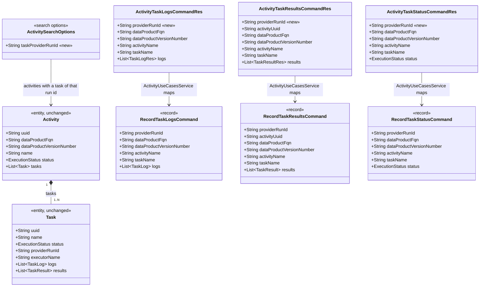

# Address a running task by provider run id (Record Task Logs, Results and Status)

Story **BDMD-5443**. This is the DevOps server change planned in `odm-cli/spdd/analysis/BDMD-5443-202610261616-[Analysis]-devops-v2-cli-commands.md`: DD-17, Q12, and the section "DevOps change: address the running task by provider run id". The CLI side is `odm-cli/spdd/prompt/BDMD-5443-202610291156-[Feat]-commands-devops-v2-start-complete-task.md`, and it depends on this change. It extends the instrumented path of BDMD-5442.

## Requirements

- **Let a pipeline write to its running task with only its run id.** Record Task Logs, Record Task Results and Record Task Status accept `providerRunId` as a third way to address the task. The other two ways stay: the natural key (data product FQN, version number, activity name, plus task name) and, for results only, the activity uuid plus task name. With the run id, a pipeline needs no version, FQN, activity or task name. This is what lets:
  - `odm-cli complete-task` close an instrumented task;
  - a full-control pipeline upload results with `CI_PIPELINE_ID`.
- **Never write to the wrong task:**
  - match only tasks that are `RUNNING`;
  - refuse a run id that matches more than one running task, naming the matches;
  - answer 404 when none matches, so the caller can retry during the full-control gap.
- **Keep every existing rule:**
  - the instrumented-only checks on logs and status;
  - the `RUNNING` check;
  - the advance of the activity after a status;
  - the existing addresses and their messages, for other callers.
- **Boundaries:**
  - no change to the executor contract, the database schema, events, Request Task Execution or Execute Task;
  - one new search filter on `GET /activities`, `taskProviderRunId` (the run-id lookup reuses the activity search, per PR review);
  - no authorization.

## Entities



Conservative scope:
- **Entities, schema and response type are unchanged.** No new entity, column, migration or response type. The index `activities_tasks_provider_run_id_idx` already exists (`V1__init_schema.sql`). Every endpoint still returns `ActivityTaskCommandResultRes`.
- **Commands gain one field each.** `providerRunId` is the first component of each command record, so the address fields read in one block.

## Approach

1. **API: an additive change, version 2 stays.**
   - **Request field.** `providerRunId` is a new optional field on the three request resources. Existing callers are unaffected.
   - **OpenAPI.** The three operations and their `@Schema` say:
     - the request takes exactly one address;
     - with a run id, `taskName` is optional and narrows the match;
     - the possible responses are 404 (no `RUNNING` task with that run id) and 400 (more than one match, or a mixed address).
2. **Address validation, in each use case's `validateCommand()`:**
   - **Address kinds.** Each kind counts as present when any of its fields has text: the run id; the natural key (FQN, version number, activity name); and, for results only, the activity uuid.
   - **No address:** 400 "Provider run id or data product FQN, version number, and activity name are required". For results: "Provider run id, activity UUID, or data product FQN, version number, and activity name are required".
   - **More than one kind:** 400 "Send only one task address: provider run id, activity UUID, or data product FQN, version number, and activity name". Logs and status omit "activity UUID".
   - **A natural key with missing parts:** the existing per-field messages, unchanged.
   - **`taskName`:** required with the natural key or the activity uuid ("Task name is required", unchanged), optional with the run id.
   - **Ordering.** The command's content checks (logs, results, status value) run after the address checks, as today.
3. **Lookup by run id, in each use case, inside the existing write transaction:**
   - **Search.** The persistence port returns the activities that have a `RUNNING` task with that run id, each loaded for update with its tasks. The port does not decide; the use case does (the "port returns data" rule).
   - **Candidates.** The use case collects the `RUNNING` tasks with that run id across those activities. When `taskName` is given, only tasks with that name count.

     | Candidates | Outcome |
     | --- | --- |
     | 0 | `NotFoundException("No RUNNING task with provider run id <id>")`, or `"… and task name <name>"` when `taskName` was given. |
     | More than 1 | `BadRequestException("Provider run id <id> matches more than one RUNNING task: task <name> of activity <uuid>, …")`. |
     | 1 | That activity and task are used, and `taskName` is set to the task's name. The rest of the procedure is unchanged: `requireInstrumented` (logs, status), `requireRunning`, append or set the status, save, and for status the advance and re-read. |
4. **Persistence:**
   - **Activity search.** The port searches with `ActivitySearchOptions`: `taskProviderRunId = <id>` and `statuses = {RUNNING}` (a task can only run inside a `RUNNING` activity). The filter maps to a new specification, `ActivitiesRepository.Specs.hasTaskWithProviderRunId(providerRunId)`: a join on `Activity.tasks` with `providerRunId = ?`, and `query.distinct(true)`. The task-level `RUNNING` check stays in the use case (`runningTasksWithRunId`).
   - **Index.** The existing index on `provider_run_id` serves the query.
   - **Search filter.** The specification is wired into `getSpecFromFilters`, so `GET /activities` gains the `taskProviderRunId` query parameter.
5. **Concurrency:**
   - **Unchanged.** Every write still reloads the activity and overwrites it under the transactional port's serializable isolation. A race between a results upload and `ExecuteTask.recordProviderRunId` or the executor outcome ends in a 409 from `ResponseExceptionHandler`, which the CLI retries.
   - **Full-control gap.** The window between the task becoming `RUNNING` and its run id being stored is answered with 404. The caller retries; the server does not wait.
6. **Risks and their mitigations:**

   | Risk | Mitigation |
   | --- | --- |
   | The run id is not unique: old tasks keep their ids, and different CI systems can collide | Only `RUNNING` tasks match, and an ambiguous id is refused. |
   | A collision during the full-control gap | Accepted. `taskName` narrows the match for callers that know it. |
   | A blank run id makes the filter return `null`, so the search would match every `RUNNING` activity | The use cases call the port only with a non-blank, trimmed run id. |

## Structure

### Inheritance Relationships
1. **Use cases:** `RecordTaskLogs`, `RecordTaskResults` and `RecordTaskStatus` keep implementing `UseCase`. They stay package-private.
2. **Core service:** `ActivityServiceImpl` keeps extending `GenericMappedAndFilteredCrudServiceImpl<ActivitySearchOptions, ActivityRes, Activity, String>`. `ActivityService` gets no new method.
3. **Exceptions:** no new types. `BadRequestException` (400) and `NotFoundException` (404) are the existing `DevOpsApiException` types, handled by `ResponseExceptionHandler`.

### Dependencies
1. `ActivityUseCaseController` → `ActivityUseCasesService.recordTask{Logs,Results,Status}` (signatures unchanged).
2. `ActivityUseCasesService` maps `providerRunId` from each `*CommandRes` into the command and calls the factories (unchanged).
3. Each `RecordTask*PersistenceOutboundPortImpl` → `ActivityService.findAllFiltered(Pageable.unpaged(), options)` and `EntityInitAndDetachService.refresh`.
4. `ActivityServiceImpl.getSpecFromFilters` → `ActivitiesRepository.Specs.hasTaskWithProviderRunId`.

### Layered Architecture
1. **Controller** (`rest.v2.controllers.ActivityUseCaseController`): OpenAPI descriptions only.
2. **Resources** (`rest.v2.resources.activity.usecases.task`): the new `providerRunId` field.
3. **Use cases service** (`activity.services.ActivityUseCasesService`): `*Res` → command, as today.
4. **Use cases** (`activity.services.usecases.recordtask{logs,results,status}`): the address rule and the run-id lookup policy.
5. **Ports** (`RecordTask*PersistenceOutboundPort[Impl]`): the new query, with no decision.
6. **Search options, core and repository** (`rest.v2.resources.activity.ActivitySearchOptions`, `activity.services.core.ActivityServiceImpl`, `activity.repositories.ActivitiesRepository`): the filter field, its wiring and the specification.
7. **Exception handling:** the existing `ResponseExceptionHandler`. Nothing changes.

## Operations

Execution order: 1 → 2 → 3 → 4 → 5 → 6 → 7 → 8 → 9.

### 1. Update Repository - `ActivitiesRepository.Specs`
1. Responsibility: select the activities that have a task with a given provider run id.
2. Method: `static Specification<Activity> hasTaskWithProviderRunId(String providerRunId)`. Logic:
   - a blank id → `null`, like the other filter specs;
   - otherwise `query.distinct(true)`, `Join<Activity, Task> tasks = root.join(Activity_.tasks)`, and `cb.equal(tasks.get(Task_.providerRunId), providerRunId)`.

### 2. Update Search Options and Core Service - `ActivitySearchOptions`, `ActivityServiceImpl`
1. `ActivitySearchOptions`: add `private String taskProviderRunId;` with a getter and a setter.
2. `ActivityServiceImpl.getSpecFromFilters`: add `hasTaskWithProviderRunId(filters.getTaskProviderRunId())`.
3. `ActivityService` gets no new method. The ports use `findAllFiltered`, which runs inside the caller's transaction (the use case's `TransactionalOutboundPort`), like `findOpenActivities`.

### 3. Update Resources - `ActivityTaskLogsCommandRes`, `ActivityTaskResultsCommandRes`, `ActivityTaskStatusCommandRes`
1. Add `private String providerRunId;` with a getter and a setter. It is the first field.
2. `@Schema(description = "Provider run id of the RUNNING task to address. Use it instead of the other address fields. With it, taskName is optional and narrows the match.")`.
3. Update the `@Schema` descriptions of the existing address fields to say that each is one of the alternative addresses.

### 4. Update Use Cases Service - `ActivityUseCasesService`
1. `recordTaskLogs`, `recordTaskResults` and `recordTaskStatus` pass `commandRes.getProviderRunId()` as the first command component.
2. The null-`commandRes` branches pass one more `null`.

### 5. Update Use Case - `RecordTaskResults` (`activity.services.usecases.recordtaskresults`)
1. **Command:** `RecordTaskResultsCommand(String providerRunId, String activityUuid, String dataProductFqn, String dataProductVersionNumber, String activityName, String taskName, List<TaskResult> results)`.
2. **Port:** add `List<Activity> findActivitiesByTaskProviderRunId(String providerRunId)` to `RecordTaskResultsPersistenceOutboundPort`. It returns a list because a run id is not unique across activities, and the use case must refuse an ambiguous one. In the implementation, search with `ActivitySearchOptions` (`taskProviderRunId`, `statuses = {RUNNING}`) through `activityService.findAllFiltered(Pageable.unpaged(), options)`, then load each match with the existing `findForUpdate(uuid)` (`findOne` + `refresh`) so its tasks are loaded.
3. **`execute()`** keeps its shape, with one named step for loading:
   ```
   validateCommand();
   transactionalPort.doInTransaction(() -> {
       Activity activity = loadActivity();
       Task task = resolveTask(activity);
       requireRunning(task);
       appendTo(task);
       presenter.presentTaskResultsRecorded(persistencePort.save(activity));
   });
   ```
4. **`loadActivity()`** selects by address kind:
   - run id → `activityOfRunningTask()`;
   - activity uuid → `persistencePort.findForUpdate(activityUuid)`;
   - otherwise → `openActivityByNaturalKey()`, which is the current inline block moved unchanged.
5. **`activityOfRunningTask()`:**
   1. Read `persistencePort.findActivitiesByTaskProviderRunId(providerRunId)`.
   2. Collect the candidates with `runningTasksWithRunId(activities)`.
   3. Apply `noRunningTask(candidates)` and `ambiguousRunId(candidates)`.
   4. Set `taskName` to the candidate's name.
   5. Return the candidate's activity.

   The candidates are pairs of activity and task, held in a private record `RunningTaskMatch(Activity activity, Task task)` nested in the use case.
6. **`validateCommand()`:**
   - trims `providerRunId`;
   - replaces `requireActivityKey()` with `requireOneAddress()`;
   - requires `taskName` only when there is no run id;
   - leaves the results checks unchanged.
7. **Rules** (private methods at the bottom):
   - `requireOneAddress()`;
   - `noRunningTask(List<RunningTaskMatch>)`;
   - `ambiguousRunId(List<RunningTaskMatch>)`;
   - `runningTasksWithRunId(List<Activity>)`, which keeps tasks with status `RUNNING`, an equal `providerRunId` and, if `taskName` has text, an equal name.

   The messages are those in Approach 2 and 3.
8. **Javadoc of the class:** "The caller sends the provider run id, the activity uuid, or the data product, version number, and activity name."

### 6. Update Use Case - `RecordTaskLogs` (`activity.services.usecases.recordtasklogs`)
1. **Command:** `RecordTaskLogsCommand(String providerRunId, String dataProductFqn, String dataProductVersionNumber, String activityName, String taskName, List<TaskLog> logs)`.
2. **Port:** the same new method and implementation as in Operation 5.2.
3. **`execute()`:**
   ```
   validateCommand();
   transactionalPort.doInTransaction(() -> {
       Activity activity = loadActivity();
       Task task = resolveTask(activity);
       requireInstrumented(task);
       requireRunning(task);
       appendTo(task);
       presenter.presentTaskLogsRecorded(persistencePort.save(activity));
   });
   ```
   `loadActivity()` takes one of two branches: run id → `activityOfRunningTask()`; otherwise → `openActivityByNaturalKey()`, the current inline block moved unchanged.
4. **`validateCommand()`:** `requireOneAddress()` (run id or natural key). The per-field natural-key messages apply only when no run id is given. `taskName` is required only without a run id.
5. **Rules:** `requireOneAddress`, `noRunningTask`, `ambiguousRunId` and `runningTasksWithRunId`, as in Operation 5.7, without the activity uuid kind.
6. **`requireInstrumented`:** unchanged. A full-control task found by run id is refused with "Task <name> is not instrumented".

### 7. Update Use Case - `RecordTaskStatus` (`activity.services.usecases.recordtaskstatus`)
1. **Command:** `RecordTaskStatusCommand(String providerRunId, String dataProductFqn, String dataProductVersionNumber, String activityName, String taskName, ExecutionStatus status)`.
2. **Port:** add `findActivitiesByTaskProviderRunId` to `RecordTaskStatusPersistenceOutboundPort` and its implementation, as in Operation 5.2.
3. **`execute()`:** unchanged: `validateCommand(); recordTerminalStatus(); advancePort.advanceActivity(activityUuid); presentAdvancedActivity();`.
4. **`recordTerminalStatus()`:** the callback's first statement becomes `Activity activity = loadActivity();` (two branches, as in Operation 6.3). The rest is unchanged:
   - `resolveTask`;
   - `requireInstrumented`;
   - `requireRunning`;
   - set the status and `finishedAt`;
   - save;
   - return the uuid.
5. **`validateCommand()` and rules:** as in Operation 6.4–6.5. The status-value check is unchanged.

### 8. Update Controller and docs
1. **`ActivityUseCaseController`:**
   - Update the `@Operation(description)` of `/tasks/logs`, `/tasks/results` and `/tasks/status` to name the three addresses and the optional `taskName` with a run id.
   - Change the 404 `@ApiResponse` text to "No open activity, or no RUNNING task with the provider run id".
   - Add "more than one RUNNING task has the provider run id, or the request mixes addresses" to the 400 text.
2. **`docs/service/how-devops-works.md`:**
   - §3 "How instrumented works": the CLI closes its task by its run id.
   - §3 "How full control works": the pipeline uploads results with its run id, for example `CI_PIPELINE_ID` on GitLab. In a child or downstream pipeline the parent's id must be passed down.
   - §3 "Details": the address rules, the 404 retry during the full-control gap, and the ambiguity refusal.
   - §8 "Known limitations": the run id is not unique across CI systems, and a collision during the full-control gap is accepted.

### 9. Create Tests
1. **Unit tests** (`*Test`, plain JUnit, in-memory fakes like `CancelActivityTest`'s `FakePersistence` and `DirectTransactions`):
   - **`RecordTaskResultsTest`** (`activity.services.usecases.recordtaskresults`): each address; mixed addresses; no address; run id with no match; ambiguous; narrowed by `taskName`; the natural-key and uuid paths unchanged.
   - **`RecordTaskLogsTest`:** run id success; full-control task by run id refused; ambiguous; not found.
   - **`RecordTaskStatusTest`:** run id success with the advance called once with the matched activity uuid; not found; second status by run id. The task is no longer `RUNNING`, so the result is 404.
2. **Integration tests** (`*IT`, extending `DevOpsApplicationIT`, sharing the existing test configuration). Add them to `ActivityInstrumentedFlowIT`, with helpers `postLogsByRunId`, `postResultsByRunId` and `postStatusByRunId` next to the existing `postLogs`, `postResults` and `postStatus`:
   - **Instrumented happy path:** logs, results and status by run id close the activity.
   - **Full control:** results by run id while the full-control task is `RUNNING`. Use `ScriptedExecutor`'s fixed run id and the held status, as `whenFullControlTaskRunningThenResultsRemainAfterSuccess` does.
   - **Ambiguity:** two activities on different data product versions, each with a `RUNNING` instrumented task requested with the same run id → status by run id is 400 and names both.
   - **Terminal tasks ignored:** a `SUCCEEDED` task of an earlier activity with the same run id, plus a `RUNNING` one in a new activity → the write goes to the running one.
   - **Mixed address:** 400.
   - **Unknown run id:** 404.

### High-level tests (Gherkin)

```gherkin
Feature: Address a running task by provider run id

  Scenario: Instrumented task closed by its run id
    Given an instrumented task is RUNNING with provider run id "gh-123"
    When the CLI records logs, results and status SUCCEEDED with only the provider run id
    Then each response is 200
    And the task is SUCCEEDED with the log and result stored
    And the activity is advanced

  Scenario: Full-control results uploaded by the pipeline's run id
    Given a full-control task is RUNNING and its provider run id "gl-42" is stored
    When the pipeline records results with only the provider run id
    Then the response is 200 and the result is stored on that task

  Scenario: No running task with the run id
    Given no task is RUNNING with provider run id "unknown"
    When the CLI records results with that provider run id
    Then the response is 404 "No RUNNING task with provider run id unknown"

  Scenario: Run id of a finished task is not matched
    Given a task of an earlier activity is SUCCEEDED with provider run id "gh-123"
    And a task of a new activity is RUNNING with provider run id "gh-123"
    When the CLI records results with that provider run id
    Then the result is stored on the RUNNING task only

  Scenario: Run id shared by two running tasks is refused
    Given two activities each have a RUNNING task with provider run id "gh-123"
    When the CLI records the status with that provider run id
    Then the response is 400 naming both tasks and activities
    And no task changes

  Scenario: Task name narrows a shared run id
    Given two activities each have a RUNNING task with provider run id "gh-123", named "build" and "deploy"
    When the CLI records results with that provider run id and task name "deploy"
    Then the result is stored on the "deploy" task

  Scenario: Logs by run id refused for a full-control task
    Given a full-control task is RUNNING with provider run id "gl-42"
    When the CLI records logs with that provider run id
    Then the response is 400 "Task <name> is not instrumented"

  Scenario: Mixed addresses are refused
    When the CLI records results with a provider run id and an activity uuid
    Then the response is 400 asking for only one task address

  Scenario: No address is refused
    When the CLI records the status with no provider run id and no natural key
    Then the response is 400 naming the accepted addresses

  Scenario: A second status by run id finds no running task
    Given an instrumented task was closed by its run id
    When the CLI records the status again with the same provider run id
    Then the response is 404

  Scenario: Existing natural-key address still works
    Given an instrumented task is RUNNING
    When the CLI records the status with the data product, version number, activity and task name
    Then the response is 200 as before
```

| Feature / Scenario | Test class | Method |
| --- | --- | --- |
| Run id / Instrumented task closed | `ActivityInstrumentedFlowIT` | `whenReportsByProviderRunIdThenTerminalStatusClosesTheActivity` |
| Run id / Full-control results | `ActivityInstrumentedFlowIT` | `whenFullControlTaskRunningThenResultsByProviderRunIdStored` |
| Run id / No running task | `ActivityInstrumentedFlowIT` | `whenNoRunningTaskWithProviderRunIdThenNotFound` |
| Run id / Finished task not matched | `ActivityInstrumentedFlowIT` | `whenEarlierTaskTerminalWithSameRunIdThenRunningTaskMatched` |
| Run id / Shared run id refused | `ActivityInstrumentedFlowIT` | `whenProviderRunIdMatchesTwoRunningTasksThenBadRequest` |
| Run id / Task name narrows | `RecordTaskResultsTest` | `whenRunIdSharedAndTaskNameGivenThenRecordsOnNamedTask` |
| Run id / Logs refused for full control | `RecordTaskLogsTest` | `whenRunIdMatchesFullControlTaskThenNotInstrumented` |
| Run id / Mixed addresses | `RecordTaskResultsTest` | `whenRunIdAndActivityUuidThenBadRequest` |
| Run id / No address | `RecordTaskStatusTest` | `whenNoAddressThenBadRequest` |
| Run id / Second status | `RecordTaskStatusTest` | `whenSecondStatusByRunIdThenNotFound` |
| Run id / Natural key still works | `RecordTaskStatusTest` | `whenNaturalKeyThenRecordsStatusAsBefore` |

Implement every test in the table. Each test method's Javadoc quotes its Feature and Scenario verbatim, as in the existing `ActivityInstrumentedFlowIT`. Each new test class's Javadoc references BDMD-5443 and this prompt.

## Norms

This service's norms (`spdd/norms/README.md`, `USE_CASE_IMPLEMENTATION.md`, `GENERIC-CRUD-GUIDELINES.md`) are older than the template norms in `odm-cli/spdd/norms/`. The newer ones are applied where they fit the existing code without a service-wide migration:

1. **Use case shape** (this service's `USE_CASE_IMPLEMENTATION.md`):
   - Commands carry domain data only.
   - Presenters take domain types.
   - Factories are the only `@Component` and build plain port implementations with `new`.
   - `*Res` types stay out of the use case package. They are mapped in `ActivityUseCasesService`, as the three methods do today. The newer norm moves this mapping to the controller, but that would split the pattern of one service class; that move is left to a template alignment story.
2. **The port returns data; the use case decides.** The persistence port returns the activities with a matching running task. The use case decides between 404, 400 and the match. Both norm versions state this rule.
3. **Exceptions:**
   - The use cases keep throwing the existing `DevOpsApiException` types (`BadRequestException`, `NotFoundException`), handled by `ResponseExceptionHandler`.
   - This service has no `UseCasePresenter` or `UseCaseException`, so the newer "failures go through the presenter" rule is not adopted for three use cases alone.
   - No new handler, no retry on the server.
4. **Composed method** (`odm-cli/spdd/norms/CODE_STRUCTURE.md`):
   - `execute()` stays a short script.
   - The new branch is the named step `loadActivity()`. The rules are private methods at the bottom of each use case.
   - No `*Helper`/`*Util` types, and no new shared class for the address rule.
   - The three use cases each keep their own address rules, as they already keep their own `resolveTask` and `trimToNull`.
5. **Progressive discovery** (`odm-cli/spdd/norms/PROGRESSIVE_DISCOVERY.md`): not applied to this change. Its index README, structure test and README guard cover the whole `activity.services.usecases` module, which this story does not restructure. The touched units have no step classes, so they need no L0 README under that norm either.
6. **CRUD and persistence** (`GENERIC-CRUD-GUIDELINES.md`):
   - The query is a static `Specs` method on the repository, exposed through the core service's entity-level API.
   - It is added to `getSpecFromFilters`, so the public search gains the `taskProviderRunId` filter.
   - No Flyway change.
7. **API** (`odm-cli/spdd/norms/API_DESIGN.md`):
   - The change is additive (a new optional field), so it stays in `/api/v2`.
   - Every status code the operations can return is documented in OpenAPI.
   - The error contract (`ErrorRes`) is unchanged.
8. **Testing** (`odm-cli/spdd/norms/TESTING.md`):
   - `*Test` unit tests with fakes for every new rule; `*IT` through the running application for each endpoint.
   - All ITs extend `DevOpsApplicationIT` and share its configuration. No new `@MockitoBean`, `@DirtiesContext` or per-class property overrides.
   - Each Gherkin scenario maps to one named test that quotes it.
9. **Logging:** the existing `ResponseExceptionHandler` logs refusals at INFO. The use cases add no logs. Never log request bodies.

## Safeguards

1. **Functional constraints:**
   - **Matching.** A run-id request writes only to a task whose status is `RUNNING` and whose `providerRunId` equals the given value, trimmed. With `taskName`, the name must also be equal.
   - **Exactly one address per request.** Results: run id, activity uuid, or natural key. Logs and status: run id or natural key.
   - **Ordering and mode rules are unchanged:** `RUNNING` required; logs and status for instrumented tasks only; status is the last write and advances the activity.
2. **Performance constraints:**
   - One indexed query per run-id request (`activities_tasks_provider_run_id_idx`), plus one load per matching activity. Normally there is one; an ambiguous request loads at most the matches it reports.
   - No server-side waiting or retry for the full-control gap.
3. **Security constraints:**
   - No authorization change. The Agent proxy keeps `DATAOPS_ADMIN` on these endpoints.
   - Error messages name only run ids, task names and activity uuids.
4. **Integration constraints:**
   - **Field name.** The request field is exactly `providerRunId` on all three resources, the name `odm-cli` sends.
   - **Responses.**

     | Situation | Response |
     | --- | --- |
     | Success | 200 `ActivityTaskCommandResultRes`, as today |
     | No `RUNNING` match | 404 |
     | Ambiguous match, mixed address, or no address | 400 |
     | Concurrent update | 409, as today |
   - **Unchanged:** the executor API, the events, the GitLab executor and the Request Task Execution contract.
5. **Business rule constraints:**
   - **Uniqueness.** A run id is never treated as unique. More than one `RUNNING` match is always refused, never resolved by picking one.
   - **Finished tasks.** Tasks in `PENDING`, `SUCCEEDED`, `FAILED` or `CANCELED` are never matched by run id.
   - **Existing addresses.** The natural key and the activity uuid keep their current behaviour and messages for every existing caller.
6. **Exception handling constraints:**
   - Only the existing `BadRequestException` and `NotFoundException` are thrown. Messages follow Approach 2 and 3 verbatim, so the CLI shows them as they are.
   - No stack traces or internal details in responses beyond `ErrorRes`.
7. **Technical constraints:**
   - Java 21, Spring Boot 3.5, JPA criteria with the generated metamodel (`Activity_`, `Task_`).
   - The filter specification returns `null` for a blank id, like its siblings. The use cases never call the port with a blank id.
   - No changes to `utils/**`.
8. **Data constraints:**
   - `providerRunId` is trimmed. An empty value counts as absent.
   - No schema change, no `NOT NULL`, no new index.
9. **API constraints:**
   - Additive only: the new optional field `providerRunId` on `ActivityTaskLogsCommandRes`, `ActivityTaskResultsCommandRes` and `ActivityTaskStatusCommandRes`.
   - Paths, response types and the error contract are unchanged. The OpenAPI text documents the three addresses and the 404/400 cases.
