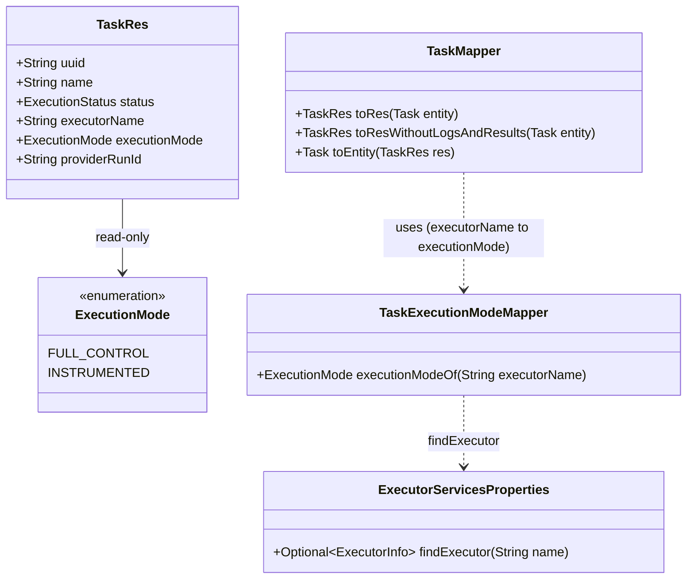

# Expose the executor execution mode on tasks

Story **BDMD-5518**. This is the DevOps server change decided in `blindata-ui/spdd/analysis/BDMD-5518-202610161639-[Analysis]-devops-v2-ui-support.md`, iteration 7, D-27. The UI side is `blindata-ui/spdd/prompt/BDMD-5518-202610191745-[Feat]-ui-devops-v2-support.md` (D-28): the activity detail page shows a hint on an instrumented task that waits for its pipeline, and hides the pipeline reference for instrumented tasks. It builds on the instrumented path of BDMD-5442, where the mode is a property of the executor declaration and is not copied onto the task.

## Requirements

- **Tell clients how each task is driven.** Every task resource carries a read-only `executionMode`: `FULL_CONTROL` or `INSTRUMENTED`, taken from the executor declaration named by the task's `executorName`. Without it a client cannot tell an instrumented task that waits for the CLI from a full-control task that waits for approval.
- **Resolve it when the task is mapped, from the current configuration.** No column, no migration. The value reflects the configuration when the response or event is built, not at execution time. An executor that is no longer declared gives `null`; mapping never fails because of it.
- **Everywhere a task is mapped to a resource.** REST responses, the V2 events that carry tasks (`ACTIVITY_EXECUTION_REQUESTED`, `ACTIVITY_TASK_EXECUTION_REQUESTED`, `ACTIVITY_EXECUTION_REJECTED`, `ACTIVITY_SUCCEEDED`, `ACTIVITY_FAILED`, `ACTIVITY_CANCELED`) and the Policy V1 document. Consumers tolerate the new key: DevOps received events ignore unknown properties, Notification stores event content opaquely, the Blindata observer disables `FAIL_ON_UNKNOWN_PROPERTIES`, and Policy V1 applies no schema to its input.
- **Never an input.** A client that sends `executionMode` in an activity or task body is ignored; nothing is stored and the response shows the configured mode.
- **Boundaries:** no change to the database schema, the use cases, the executor contract, event types, the Policy V1 adapter's code, or authorization.

## Entities

## Approach

1. **Add the field to `TaskRes` only.** `ExecutionMode executionMode` with `@Schema(accessMode = READ_ONLY)`. `Task` (the entity) does not change, so `TaskMapper.toEntity` drops the field on input.
2. **Fill it in the mapper.** `TaskMapper` lists a new `@Component` `TaskExecutionModeMapper` in `@Mapper(uses = …)`. Both `toRes` and `toResWithoutLogsAndResults` map `executionMode` from `executorName` through its `@Named("executionMode")` method. `ActivityMapper` already uses `TaskMapper`, so every activity resource with tasks (REST, events, Policy V1 input) gets the mode without further changes.
3. **The lookup never throws.** It calls `ExecutorServicesProperties.findExecutor` and returns `null` for a blank or undeclared name. The use-case `findExecutionMode` lookups, which throw, are not reused.
4. **Document the contract change** in `docs/service/how-devops-works.md` and `docs/service/events.md`.

## Structure

### Inheritance Relationships

1. No new hierarchy. `TaskExecutionModeMapper` is a plain `@Component` used by MapStruct.

### Dependencies

1. `TaskMapper` (generated `TaskMapperImpl`, Spring component model) → `TaskExecutionModeMapper` (new) → `ExecutorServicesProperties` (existing bean).
2. `ActivityMapper` → `TaskMapper` (unchanged).
3. Controllers, use-case services, use cases, notification ports and `PolicyV1InputEnricher` are unchanged; they receive the field through the mappers.

### Layered Architecture

1. REST resources: `TaskRes` gains the field; `TaskExecutionModeMapper` sits beside the mappers in `rest.v2.resources.activity`.
2. Domain, use cases, persistence, event types: unchanged.

## Operations

### 1. Update Resource - `rest.v2.resources.activity.TaskRes`

1. Add `@Schema(description = "Execution mode of the task's executor, read from the current executor configuration. Read-only: ignored on input. Null when the executor is no longer declared.", accessMode = Schema.AccessMode.READ_ONLY) private ExecutionMode executionMode;` after `executorName`, with getter and setter, in the style of the other fields.

### 2. Create Component - `rest.v2.resources.activity.TaskExecutionModeMapper`

1. `@Component public class TaskExecutionModeMapper`, with `ExecutorServicesProperties` injected through the constructor.
2. `@Named("executionMode") public ExecutionMode executionModeOf(String executorName)`: `null` for a blank name; otherwise `executorServicesProperties.findExecutor(executorName).map(ExecutorInfo::executionMode).orElse(null)`.

### 3. Update Mapper - `rest.v2.resources.activity.TaskMapper`

1. `@Mapper(componentModel = "spring", uses = TaskExecutionModeMapper.class)`.
2. Add `@Mapping(target = "executionMode", source = "executorName", qualifiedByName = "executionMode")` to `toRes` and to `toResWithoutLogsAndResults`.
3. `toEntity` needs no change: `Task` has no such property.

### 4. Update Test - `CancelActivityExecutorOutboundPortImplTest`

1. No change. It builds `new TaskMapperImpl()` outside Spring, which still compiles because MapStruct injects `uses` collaborators through a field. The port calls only the default method `jsonNodeToExecutorParameters`, which does not use `TaskExecutionModeMapper`. If a future port calls `toRes` there, the test must set the collaborator.

### 5. Update Docs

1. `docs/service/how-devops-works.md`, section 3, "Details", under "Instrumented": "Every task that DevOps returns or publishes carries `executionMode` (`FULL_CONTROL` or `INSTRUMENTED`), taken from the declaration of its executor when the task is read or the event is built. It is read-only, and it is `null` when the executor is no longer declared."
2. `docs/service/events.md`: in the section on message content, state that each task in a message carries `executionMode` with the same meaning.

### 6. Create Tests

1. `ActivityControllerIT`:
   - Create (hidden POST) an activity whose tasks use a full-control executor and the instrumented `cli` executor of the test configuration; GET returns the matching `executionMode` on each task.
   - Create with a task on an undeclared executor name: GET returns `executionMode: null` and no error.
   - Create with `executionMode: INSTRUMENTED` sent on a full-control task: the response and a later GET show `FULL_CONTROL`.
2. A unit test for `TaskExecutionModeMapper`: declared full-control, declared instrumented, undeclared and blank names.
3. Run the focused tests, then the full test suite.

### High-level tests (Gherkin)

Feature: Execution mode on tasks
  Scenario: Mode from the executor declaration
    Given executor "starter" is declared full-control and "cli" instrumented
    And an activity with one task on each
    When a client reads the activity
    Then the "starter" task has executionMode FULL_CONTROL
    And the "cli" task has executionMode INSTRUMENTED

  Scenario: Executor no longer declared
    Given a stored task whose executor is not declared any more
    When a client reads the activity
    Then the task has executionMode null
    And the read succeeds

  Scenario: The field is not an input
    Given a create request whose full-control task sends executionMode INSTRUMENTED
    When the activity is read
    Then the task has executionMode FULL_CONTROL

| Feature / Scenario | Where |
| --- | --- |
| Mode from the executor declaration | `ActivityControllerIT`, `TaskExecutionModeMapperTest` |
| Executor no longer declared | `ActivityControllerIT`, `TaskExecutionModeMapperTest` |
| The field is not an input | `ActivityControllerIT` |

## Norms

1. `spdd/norms/GENERIC-CRUD-GUIDELINES.md`: the CRUD service keeps delegating `toRes` / `toEntity` to the mappers. The anemic CRUD endpoints keep `@Hidden`.
2. `spdd/norms/USE_CASE_IMPLEMENTATION.md`: REST resources stay out of the use case packages; no use case, command, presenter or port changes. The use cases keep their own throwing `findExecutionMode` ports.
3. Composed method: the lookup is one named mapping method; no helper or util type.

## Safeguards

1. No database change: no Flyway migration, no new column, no change to `Task`.
2. The mode is never read from the request. `toEntity` drops it, and every mapping recomputes it from the configuration.
3. A missing or undeclared executor gives `null`, never an exception, so reads, events and policy input never fail because of the configuration.
4. No change to use-case behaviour, task order, approvals, cancel, the executor contract or event types. The mode stays a property of the executor declaration (BDMD-5442).
5. No authorization change: the field is part of reads and messages that are already allowed.
